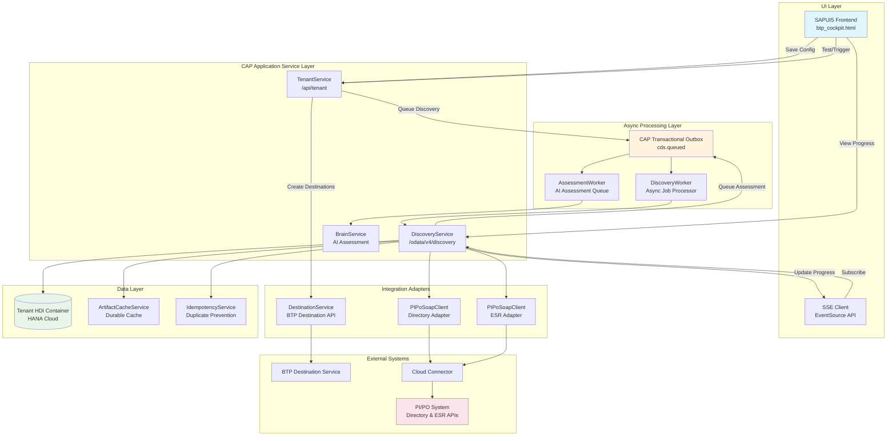
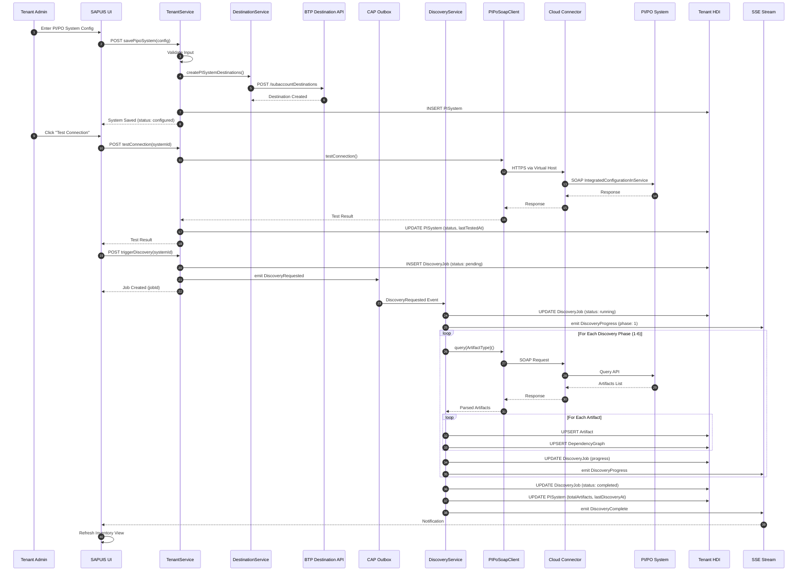
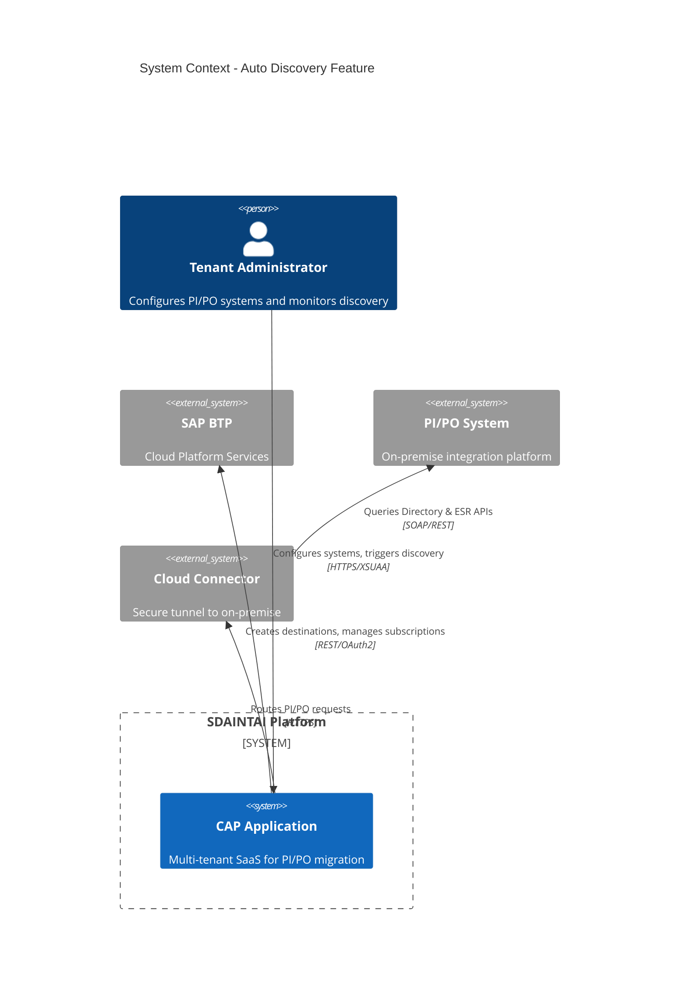
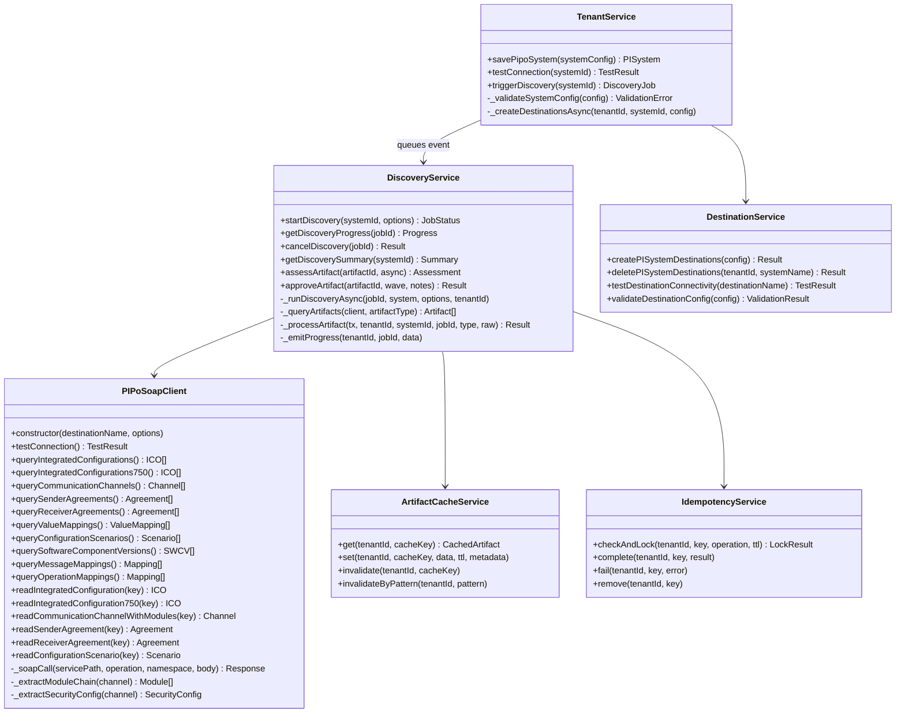
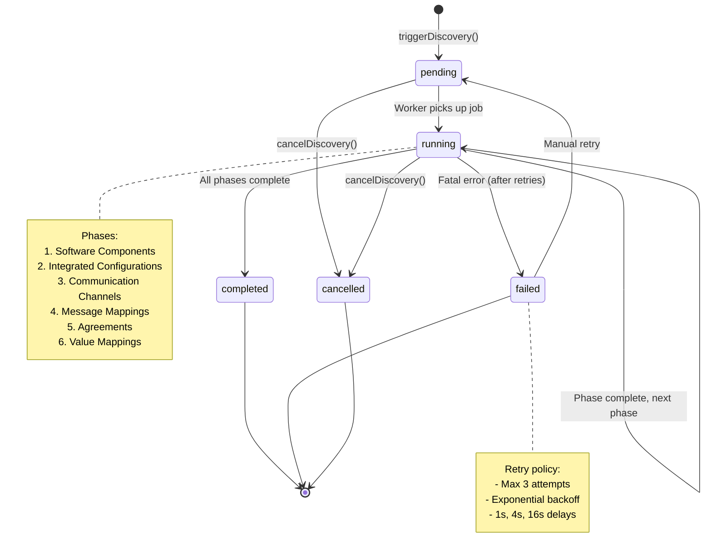
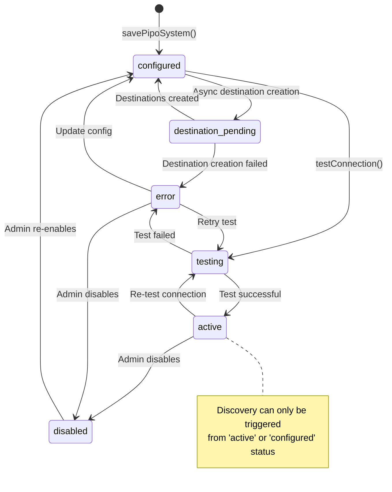
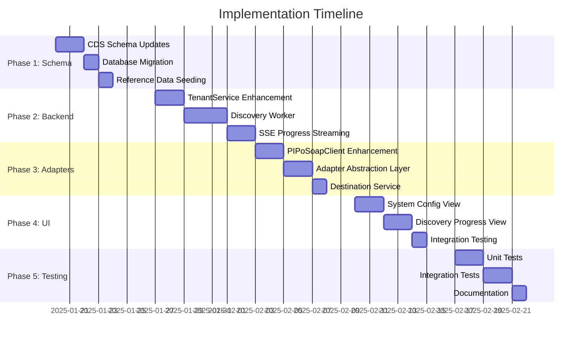

# Technical Design: Automatic PI/PO Discovery Feature

**Document Version:** 1.0  
**Date:** 2025-01-XX  
**Status:** Draft  
**Requirements Reference:** [01-requirements.md](./01-requirements.md)

---

## Table of Contents

1. [High-Level Design](#1-high-level-design)
2. [Detailed Design](#2-detailed-design)
3. [Implementation Plan](#3-implementation-plan)
4. [Risk Analysis](#4-risk-analysis)

---

## 1. High-Level Design

### 1.1 Component Diagram



### 1.2 Data Flow Diagram



### 1.3 Integration Points

| Integration Point | Protocol | Direction | Purpose | Authentication |
|-------------------|----------|-----------|---------|----------------|
| **BTP Destination Service** | REST HTTPS | Outbound | Create/manage subscription-level destinations | OAuth2 (service binding) |
| **Cloud Connector** | HTTPS | Outbound | Route requests to on-premise PI/PO | Virtual host mapping |
| **PI/PO Directory API** | SOAP over HTTPS | Outbound | Query/read ICOs, Channels, Agreements | Basic Auth (via Destination) |
| **PI/PO ESR API** | REST/SOAP over HTTPS | Outbound | Query/read Mappings, Interfaces, Types | Basic Auth (via Destination) |
| **CAP Transactional Outbox** | Internal Event | Internal | Async job processing | N/A (internal) |
| **SSE (Server-Sent Events)** | HTTP SSE | Outbound | Real-time progress to UI | XSUAA JWT |

### 1.4 System Context Diagram



---

## 2. Detailed Design

### 2.1 Class/Module Structure

#### 2.1.1 Service Layer Architecture



#### 2.1.2 Module File Structure

```
srv/
├── tenant/
│   ├── tenant-service.cds          # Service definition
│   └── tenant-service.js           # Service implementation
├── discovery-service.cds           # Discovery service definition
├── discovery-service.js            # Discovery service implementation
├── utils/
│   ├── destinationService.js       # BTP Destination API client
│   ├── pipoSoapClient.js          # PI/PO SOAP client (existing)
│   └── idempotencyService.js      # Idempotency tracking
├── cache/
│   └── artifactCacheService.js    # Durable artifact cache
└── workers/
    └── discoveryWorker.js         # Async discovery processor (NEW)
```

### 2.2 API Contracts

#### 2.2.1 TenantService API

##### savePipoSystem

```yaml
endpoint: POST /api/tenant/savePipoSystem
auth: XSUAA JWT with TenantAdmin scope
request:
  type: object
  properties:
    systemConfig:
      type: object
      required: [systemName, virtualHost, locationId, techUser]
      properties:
        systemId:
          type: string
          format: uuid
          description: null for new, ID for update
        systemName:
          type: string
          maxLength: 50
          pattern: "^[a-zA-Z0-9_]+$"
        description:
          type: string
          maxLength: 200
        virtualHost:
          type: string
          maxLength: 200
          pattern: "^[a-zA-Z0-9.-]+$"
        virtualPort:
          type: integer
          minimum: 1
          maximum: 65535
          default: 443
        protocol:
          type: string
          enum: [http, https]
          default: https
        locationId:
          type: string
          maxLength: 50
        techUser:
          type: string
          maxLength: 50
        techPassword:
          type: string
          maxLength: 100
          description: Required for new systems
        piVersion:
          type: string
          enum: ["7.31", "7.40", "7.50"]
          default: "7.50"

response:
  type: object
  properties:
    ID:
      type: string
      format: uuid
    tenantId:
      type: string
    systemName:
      type: string
    status:
      type: string
      enum: [configured, testing, active, error, disabled, destination_pending]
    destinationDir:
      type: string
    destinationEsr:
      type: string
    destinationStatus:
      type: string
      enum: [created, pending, failed]
    destinationMessage:
      type: string

errors:
  400: Validation error (missing/invalid fields)
  404: System not found (update case)
  409: System name already exists for tenant
  500: Internal error
```

##### testConnection

```yaml
endpoint: POST /api/tenant/testConnection
auth: XSUAA JWT with TenantAdmin scope
request:
  type: object
  required: [systemId]
  properties:
    systemId:
      type: string
      format: uuid

response:
  type: object
  properties:
    success:
      type: boolean
    dirStatus:
      type: string
      enum: [ok, error, timeout]
    esrStatus:
      type: string
      enum: [ok, error, timeout]
    message:
      type: string
    piVersion:
      type: string
    swcvCount:
      type: integer
    channelCount:
      type: integer

errors:
  400: systemId is required
  404: PI/PO system not found
  500: Internal error
```

##### triggerDiscovery

```yaml
endpoint: POST /api/tenant/triggerDiscovery
auth: XSUAA JWT with TenantAdmin scope
request:
  type: object
  required: [systemId]
  properties:
    systemId:
      type: string
      format: uuid
    options:
      type: object
      properties:
        includeInactive:
          type: boolean
          default: false
        includeHistory:
          type: boolean
          default: false
        artifactTypes:
          type: array
          items:
            type: string
          description: null for all types

response:
  type: object
  properties:
    ID:
      type: string
      format: uuid
    status:
      type: string
      enum: [pending, running, completed, failed, cancelled]
    startedAt:
      type: string
      format: date-time

errors:
  400: systemId required / System status prevents discovery
  404: PI/PO system not found
  409: Discovery already running for this system
  500: Internal error
```

#### 2.2.2 DiscoveryService API

##### startDiscovery

```yaml
endpoint: POST /odata/v4/discovery/startDiscovery
auth: XSUAA JWT
request:
  type: object
  required: [systemId]
  properties:
    systemId:
      type: string
      format: uuid
    includeInactive:
      type: boolean
      default: false
    includeHistory:
      type: boolean
      default: false
    artifactTypes:
      type: string
      description: JSON array or null for all

response:
  type: object
  properties:
    jobId:
      type: string
      format: uuid
    status:
      type: string
      enum: [pending, already_running]
    estimatedTime:
      type: integer
      description: Estimated seconds to completion
    message:
      type: string
```

##### getDiscoveryProgress

```yaml
endpoint: GET /odata/v4/discovery/getDiscoveryProgress(jobId={jobId})
auth: XSUAA JWT
parameters:
  jobId:
    type: string
    format: uuid
    required: true

response:
  type: object
  properties:
    jobId:
      type: string
      format: uuid
    status:
      type: string
      enum: [pending, running, completed, failed, cancelled]
    phase:
      type: integer
      minimum: 0
      maximum: 6
    phaseName:
      type: string
    progressPercent:
      type: integer
      minimum: 0
      maximum: 100
    artifactsFound:
      type: integer
    currentItem:
      type: string
    errors:
      type: string
      description: JSON array of error objects
    estimatedRemaining:
      type: integer
      description: Estimated seconds remaining
```

#### 2.2.3 SSE Events Contract

```typescript
// Event: DiscoveryProgress
interface DiscoveryProgressEvent {
  tenantId: string;
  jobId: string;
  type: 'phase_start' | 'phase_complete' | 'artifact_found' | 'error' | 'discovery_complete';
  phase?: number;
  phaseName?: string;
  progressPercent: number;
  artifactsFound?: number;
  newArtifacts?: number;
  updatedArtifacts?: number;
  errorsCount?: number;
  currentItem?: string;
  timestamp: string;
}

// SSE Endpoint
// GET /api/discovery/progress/{jobId}/stream
// Headers: Accept: text/event-stream
```

### 2.3 Database Schema Changes

#### 2.3.1 New Entity: DiscoveryPhase (Reference Data)

```cds
// db/tenant-schema.cds - ADD
entity DiscoveryPhase {
  key code            : String(50);    // IntegratedConfiguration, CommunicationChannel, etc.
  name                : String(100);
  displayOrder        : Integer;
  category            : String(20);    // directory | esr
  soapService         : String(200);
  weight              : Integer;       // Progress weight (percentage contribution)
  description         : String(500);
  timeout             : Integer default 60000;  // Milliseconds
}
```

#### 2.3.2 Enhanced PISystem Entity

```cds
// db/tenant-schema.cds - MODIFY
entity PISystem : cuid, managed {
  // ... existing fields ...
  
  // NEW: Auto-discovery configuration
  autoDiscoveryEnabled: Boolean default true;   // Toggle auto-discovery after successful test
  discoveryOptions    : LargeString;            // JSON: default options for auto-discovery
  
  // NEW: Destination status tracking  
  destinationStatus   : String(20) default 'pending';  // pending | created | failed
  destinationError    : LargeString;                   // Error details if creation failed
  destinationCreatedAt: DateTime;
  
  // NEW: Connection test history
  testHistory         : LargeString;            // JSON array of last 10 test results
}
```

#### 2.3.3 Enhanced DiscoveryJob Entity

```cds
// db/tenant-schema.cds - MODIFY  
entity DiscoveryJob : cuid, managed {
  // ... existing fields ...
  
  // NEW: Phase-level tracking
  phaseProgress       : LargeString;            // JSON: { phase1: {status, count, duration}, ... }
  
  // NEW: Cancellation support
  cancelledBy         : String(100);
  cancelledAt         : DateTime;
  cancellationReason  : String(500);
  
  // NEW: Retry tracking
  attemptNumber       : Integer default 1;
  lastError           : LargeString;
  nextRetryAt         : DateTime;
}
```

#### 2.3.4 New Entity: DiscoveryJobPhase (Detailed Phase Tracking)

```cds
// db/tenant-schema.cds - ADD
entity DiscoveryJobPhase : cuid, managed {
  tenantId            : String(50);
  job                 : Association to DiscoveryJob;
  phase               : Association to DiscoveryPhase;
  
  status              : String(20) default 'pending';  // pending | running | completed | failed | skipped
  startedAt           : DateTime;
  completedAt         : DateTime;
  durationMs          : Integer;
  
  artifactsQueried    : Integer default 0;
  artifactsProcessed  : Integer default 0;
  artifactsNew        : Integer default 0;
  artifactsUpdated    : Integer default 0;
  
  errorCount          : Integer default 0;
  errors              : LargeString;            // JSON array of phase-specific errors
}
```

#### 2.3.5 Database Indexes

```sql
-- Performance indexes for tenant-isolated queries
CREATE INDEX idx_pisystem_tenant_status ON PISystem(tenantId, status);
CREATE INDEX idx_discoveryjob_tenant_system ON DiscoveryJob(tenantId, system_ID, status);
CREATE INDEX idx_artifact_tenant_system_type ON Artifact(tenantId, system_ID, artifactType);
CREATE INDEX idx_artifact_tenant_status ON Artifact(tenantId, migrationStatus);
CREATE INDEX idx_auditlog_tenant_action ON AuditLog(tenantId, action, createdAt);

-- Idempotency lookup (existing in idempotency-schema.cds)
-- Cache lookup (existing in cache-schema.cds)
```

### 2.4 State Machine: Discovery Job Lifecycle



### 2.5 State Machine: PI/PO System Lifecycle



---

## 3. Implementation Plan

### 3.1 File Changes Needed

| File | Type | Changes |
|------|------|---------|
| `srv/tenant/tenant-service.js` | Modify | Add auto-discovery trigger after successful testConnection |
| `srv/tenant/tenant-service.cds` | Modify | Add `autoDiscoveryEnabled` parameter to savePipoSystem |
| `srv/discovery-service.js` | Modify | Add SSE progress streaming, enhance phase tracking |
| `srv/discovery-service.cds` | Modify | Add SSE event definitions |
| `srv/utils/destinationService.js` | Modify | Add subscription-level destination support |
| `srv/utils/pipoSoapClient.js` | Modify | Add remaining Directory API methods (AlertRule, Party, BusinessSystem) |
| `db/tenant-schema.cds` | Modify | Add new fields and entities per schema changes |

### 3.2 New Files to Create

| File | Purpose |
|------|---------|
| `srv/workers/discoveryWorker.js` | Dedicated async worker for discovery job processing |
| `srv/sse/progressStream.js` | SSE endpoint handler for real-time progress |
| `srv/adapters/directoryAdapter.js` | Abstraction layer for PI/PO Directory API calls |
| `srv/adapters/esrAdapter.js` | Abstraction layer for PI/PO ESR API calls |
| `srv/handlers/discoveryEventHandler.js` | Event handlers for discovery lifecycle events |
| `app/aiconx/webapp/controller/SystemConfig.controller.js` | UI controller for system configuration |
| `app/aiconx/webapp/view/SystemConfig.view.xml` | UI view for system configuration |
| `app/aiconx/webapp/controller/DiscoveryProgress.controller.js` | UI controller for progress monitoring |
| `app/aiconx/webapp/view/DiscoveryProgress.view.xml` | UI view for progress monitoring |
| `test/discovery-service.test.js` | Unit tests for discovery service |
| `test/tenant-service.test.js` | Unit tests for tenant service |

### 3.3 Dependencies to Add

```json
// package.json additions
{
  "dependencies": {
    "@sap-cloud-sdk/connectivity": "^3.x",
    "@sap-cloud-sdk/http-client": "^3.x"
  }
}
```

**Note:** These dependencies are already implicitly available through `@sap/cds` but explicit addition ensures correct version resolution for advanced Destination Service operations.

### 3.4 Migration Steps

#### Phase 1: Schema Migration (Week 1)

1. **Update CDS Schema**
   - Add new fields to `PISystem` entity
   - Add new fields to `DiscoveryJob` entity
   - Create `DiscoveryPhase` reference entity
   - Create `DiscoveryJobPhase` tracking entity

2. **Database Migration**
   - Run `cds deploy --to hana` against development HDI container
   - Verify schema changes in HANA Cloud
   - Create performance indexes

3. **Seed Reference Data**
   - Populate `DiscoveryPhase` with 6 discovery phases
   - Populate `ArtifactType` reference data (if not already present)

#### Phase 2: Backend Services (Week 2)

1. **Enhance TenantService**
   - Implement auto-discovery trigger after successful connection test
   - Add `autoDiscoveryEnabled` toggle support
   - Enhance destination creation with better error handling

2. **Create Discovery Worker**
   - Extract async discovery logic from `discovery-service.js`
   - Implement proper phase-level progress tracking
   - Add retry logic with exponential backoff
   - Implement cancellation support

3. **Implement SSE Progress Streaming**
   - Create SSE endpoint handler
   - Wire progress events from discovery worker
   - Add heartbeat mechanism for connection keep-alive

#### Phase 3: Adapter Enhancements (Week 3)

1. **Enhance PIPoSoapClient**
   - Add remaining Directory API methods
   - Improve error handling and timeout management
   - Add connection pooling for efficiency

2. **Create Adapter Abstraction Layer**
   - Create `directoryAdapter.js` for Directory API operations
   - Create `esrAdapter.js` for ESR API operations
   - Implement mock adapters for local development

3. **Enhance Destination Service**
   - Add subscription-level destination creation
   - Implement destination validation
   - Add destination health check

#### Phase 4: UI Implementation (Week 4)

1. **System Configuration View**
   - Create form for PI/PO system configuration
   - Add "Test Connection" button with result display
   - Add auto-discovery toggle
   - Show destination creation status

2. **Discovery Progress View**
   - Create progress bar with phase indicators
   - Implement SSE-based real-time updates
   - Add artifact count display
   - Add error/warning log panel

3. **Integration Testing**
   - End-to-end flow testing
   - Multi-tenant isolation verification
   - Performance testing with large artifact sets

#### Phase 5: Testing & Documentation (Week 5)

1. **Unit Tests**
   - Service layer tests
   - Adapter tests with mocks
   - Cache service tests
   - Idempotency service tests

2. **Integration Tests**
   - Full discovery flow tests
   - SSE streaming tests
   - Cancellation flow tests

3. **Documentation**
   - API documentation
   - Configuration guide
   - Troubleshooting guide

### 3.5 Implementation Sequence Diagram



---

## 4. Risk Analysis

### 4.1 Technical Risks

| Risk ID | Risk | Probability | Impact | Mitigation Strategy |
|---------|------|-------------|--------|---------------------|
| **TR-001** | PI/PO SOAP API availability varies by version | Medium | High | Implement version detection and fallback logic; test against multiple PI/PO versions (7.31, 7.40, 7.50) |
| **TR-002** | Large artifact sets (>10,000) cause timeout | Medium | Medium | Implement pagination and batching; configurable timeout per artifact type; phase-level checkpointing for resume |
| **TR-003** | Cloud Connector connectivity issues | Medium | High | Implement robust retry logic; health check endpoint; clear error messages for CC configuration issues |
| **TR-004** | SSE connection drops in long-running discoveries | Medium | Low | Implement heartbeat mechanism; client-side reconnection logic; polling fallback |
| **TR-005** | Concurrent discoveries cause resource contention | Low | Medium | Implement per-tenant concurrency limits; queue depth monitoring; rate limiting |
| **TR-006** | BTP Destination Service quota limits | Low | Medium | Reuse destinations across systems where possible; implement destination cleanup; document quota requirements |
| **TR-007** | HANA Cloud performance with large artifact tables | Low | High | Implement proper indexing; use batch inserts; consider table partitioning for very large tenants |
| **TR-008** | Memory exhaustion processing large XML responses | Low | High | Implement streaming XML parsing; process artifacts in chunks; monitor Node.js heap usage |

### 4.2 Mitigation Strategies

#### TR-001: PI/PO Version Compatibility

```javascript
// Implement version detection and service selection
async _selectIcoService(system) {
  if (system.piVersion >= '7.50') {
    try {
      // Try 7.50-specific service first
      await this._testService750();
      return SOAP_SERVICES.IntegratedConfiguration750;
    } catch (e) {
      LOG.warn('7.50 service unavailable, falling back', { error: e.message });
    }
  }
  return SOAP_SERVICES.IntegratedConfiguration;
}
```

#### TR-002: Large Artifact Set Handling

```javascript
// Implement batched processing with checkpoints
async _processArtifactsInBatches(artifacts, batchSize = 100) {
  const batches = this._chunkArray(artifacts, batchSize);
  
  for (let i = 0; i < batches.length; i++) {
    // Save checkpoint before each batch
    await this._saveCheckpoint(jobId, { 
      phase: currentPhase, 
      batchIndex: i, 
      processedCount: i * batchSize 
    });
    
    await this._processBatch(batches[i]);
    
    // Check for cancellation between batches
    if (await this._isCancelled(jobId)) break;
  }
}
```

#### TR-003: Cloud Connector Resilience

```javascript
// Implement circuit breaker pattern
class CircuitBreaker {
  constructor(options = {}) {
    this.failureThreshold = options.failureThreshold || 5;
    this.resetTimeout = options.resetTimeout || 300000; // 5 minutes
    this.failures = 0;
    this.state = 'CLOSED';
    this.lastFailureTime = null;
  }
  
  async execute(fn) {
    if (this.state === 'OPEN') {
      if (Date.now() - this.lastFailureTime > this.resetTimeout) {
        this.state = 'HALF_OPEN';
      } else {
        throw new Error('Circuit breaker is OPEN - PI/PO connection unavailable');
      }
    }
    
    try {
      const result = await fn();
      this._onSuccess();
      return result;
    } catch (error) {
      this._onFailure();
      throw error;
    }
  }
  
  _onSuccess() {
    this.failures = 0;
    this.state = 'CLOSED';
  }
  
  _onFailure() {
    this.failures++;
    this.lastFailureTime = Date.now();
    if (this.failures >= this.failureThreshold) {
      this.state = 'OPEN';
    }
  }
}
```

#### TR-004: SSE Connection Reliability

```javascript
// Client-side SSE with auto-reconnection
class DiscoveryProgressStream {
  constructor(jobId) {
    this.jobId = jobId;
    this.reconnectAttempts = 0;
    this.maxReconnectAttempts = 10;
    this.reconnectDelay = 1000;
  }
  
  connect() {
    this.eventSource = new EventSource(`/api/discovery/progress/${this.jobId}/stream`);
    
    this.eventSource.onmessage = (event) => {
      this.reconnectAttempts = 0;
      this._handleProgress(JSON.parse(event.data));
    };
    
    this.eventSource.onerror = () => {
      this.eventSource.close();
      this._reconnect();
    };
  }
  
  _reconnect() {
    if (this.reconnectAttempts < this.maxReconnectAttempts) {
      this.reconnectAttempts++;
      const delay = this.reconnectDelay * Math.pow(2, this.reconnectAttempts - 1);
      setTimeout(() => this.connect(), delay);
    } else {
      // Fall back to polling
      this._startPolling();
    }
  }
}
```

### 4.3 Contingency Plans

| Risk | Trigger | Contingency Action |
|------|---------|-------------------|
| **TR-001** | Service returns "Not Found" or "Not Implemented" | Log warning, skip to standard service, flag artifact type as "limited discovery" |
| **TR-002** | Discovery exceeds 30-minute timeout | Save partial results, mark job as "partial", allow manual resume |
| **TR-003** | 5 consecutive Cloud Connector failures | Open circuit breaker, return "connectivity_unavailable" error, prompt user to check CC status |
| **TR-004** | SSE connection fails 10 times | Automatically switch to polling mode (5-second interval) |
| **TR-005** | >10 concurrent jobs system-wide | Queue excess jobs with "pending" status, implement fair scheduling |
| **TR-006** | Destination quota exceeded | Return clear error message with instructions to contact BTP administrator |
| **TR-007** | Query timeout on Artifact table | Implement query pagination, reduce default page size |
| **TR-008** | Node.js heap > 80% | Log warning, skip artifact raw XML storage, process only metadata |

### 4.4 Monitoring & Alerting Requirements

| Metric | Threshold | Alert Action |
|--------|-----------|--------------|
| Discovery job duration | > 30 minutes | Warning notification to admin |
| Discovery error rate | > 10% of artifacts | Log analysis trigger |
| Active concurrent jobs | > 10 | Scale worker pool |
| Cloud Connector latency | > 5 seconds avg | Network investigation |
| Destination creation failures | > 3 consecutive | Destination service health check |
| SSE connection drops | > 50/hour | Frontend reconnection logic review |
| HANA query duration | > 10 seconds | Index optimization review |

---

## Appendix A: API Endpoint Summary

| Endpoint | Method | Service | Purpose |
|----------|--------|---------|---------|
| `/api/tenant/savePipoSystem` | POST | TenantService | Create/update PI/PO system config |
| `/api/tenant/testConnection` | POST | TenantService | Test PI/PO connectivity |
| `/api/tenant/triggerDiscovery` | POST | TenantService | Manually trigger discovery |
| `/odata/v4/discovery/startDiscovery` | POST | DiscoveryService | Start discovery job |
| `/odata/v4/discovery/getDiscoveryProgress` | GET | DiscoveryService | Get job progress |
| `/odata/v4/discovery/cancelDiscovery` | POST | DiscoveryService | Cancel running job |
| `/odata/v4/discovery/getDiscoverySummary` | GET | DiscoveryService | Get system artifact summary |
| `/api/discovery/progress/{jobId}/stream` | GET | SSE Endpoint | Real-time progress stream |

---

## Appendix B: Configuration Reference

### Environment Variables

| Variable | Default | Description |
|----------|---------|-------------|
| `DISCOVERY_TIMEOUT_MS` | 1800000 | Overall discovery job timeout (30 min) |
| `SOAP_REQUEST_TIMEOUT_MS` | 60000 | Individual SOAP call timeout (60s) |
| `DISCOVERY_BATCH_SIZE` | 100 | Artifacts per batch for DB writes |
| `DISCOVERY_MAX_CONCURRENT` | 10 | Max concurrent jobs across tenants |
| `SSE_HEARTBEAT_INTERVAL_MS` | 30000 | SSE keepalive interval |
| `CIRCUIT_BREAKER_THRESHOLD` | 5 | Failures before circuit opens |
| `CIRCUIT_BREAKER_RESET_MS` | 300000 | Circuit breaker reset timeout |

### CAP Configuration (package.json)

```json
{
  "cds": {
    "requires": {
      "outbox": {
        "kind": "persistent-outbox",
        "maxAttempts": 10,
        "chunkSize": 100,
        "parallelism": 5
      },
      "destinations": true,
      "connectivity": true
    }
  }
}
```

---

## Appendix C: Error Codes

| Code | HTTP Status | Message | Resolution |
|------|-------------|---------|------------|
| `PIPO-001` | 503 | Cloud Connector location not found | Verify CC is running and location ID matches |
| `PIPO-002` | 503 | Virtual host not reachable | Check CC virtual host mapping |
| `PIPO-003` | 401 | Invalid credentials | Verify PI/PO tech user and password |
| `PIPO-004` | 403 | Insufficient permissions | Grant required PI/PO authorizations |
| `PIPO-005` | 504 | SOAP request timeout | Increase timeout or reduce batch size |
| `PIPO-006` | 500 | Invalid SOAP response | Check PI/PO version compatibility |
| `PIPO-007` | 400 | Artifact limit exceeded | Use incremental discovery |
| `PIPO-008` | 503 | Destination creation failed | Check Destination service quota |
| `PIPO-009` | 500 | Internal processing error | Contact support with job ID |
| `PIPO-010` | 409 | Discovery already running | Wait for current job or cancel it |
| `PIPO-011` | 400 | System status prevents discovery | Test connection first |

---

*Document End*
