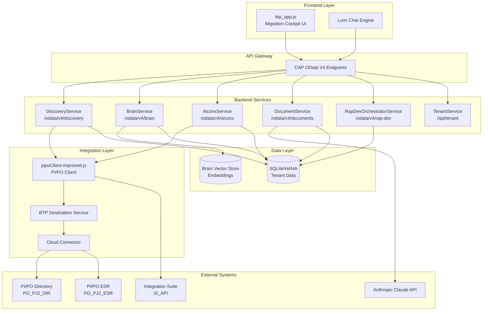
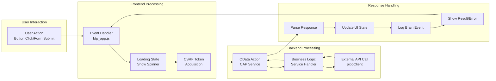
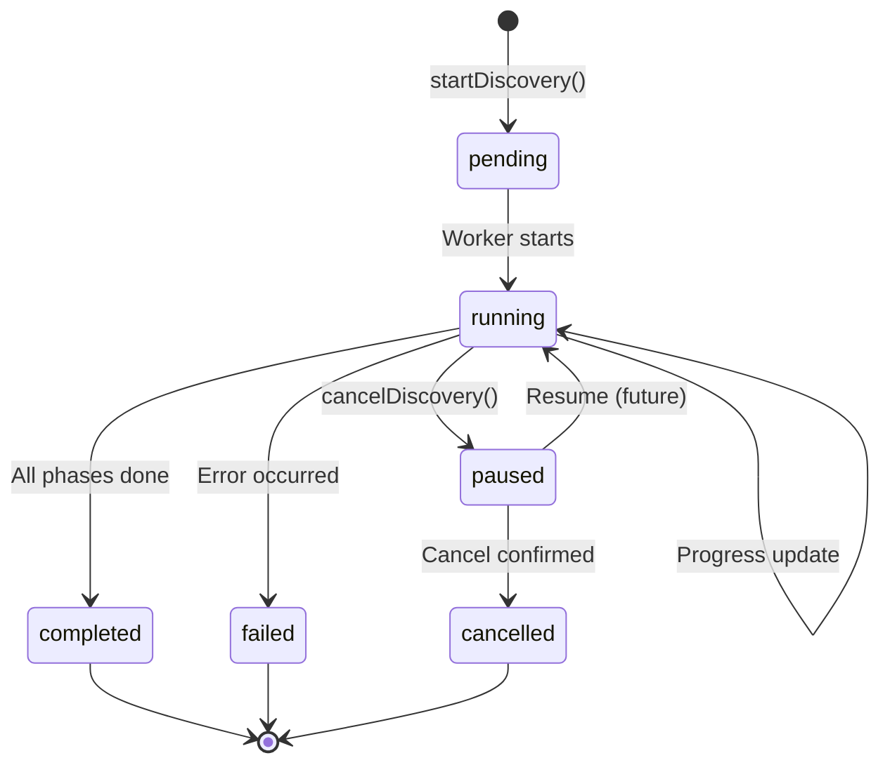
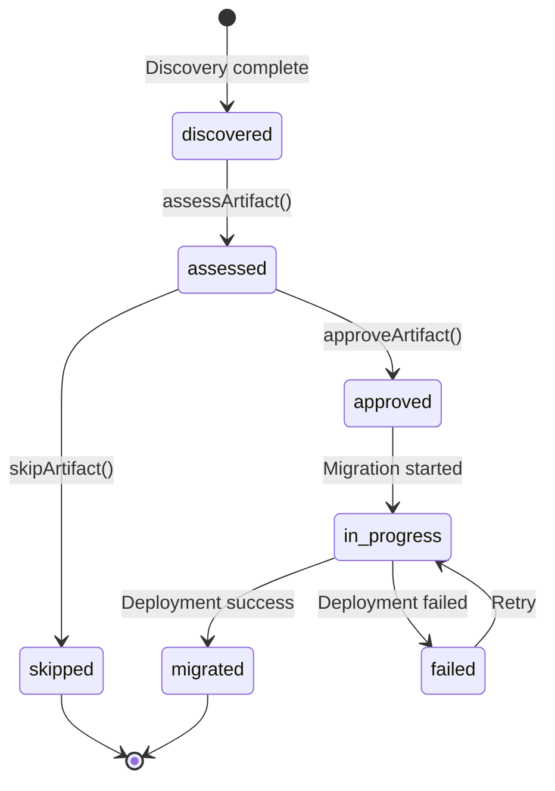

# Technical Design: Wire UI Controls to Backend Logic

**Project:** ZR_SDAINTAI_V01 — SDAINT-AI Migration Cockpit  
**Version:** 1.0  
**Date:** 2025-01-13  
**Status:** Draft

---

## 1. High-Level Design

### 1.1 Component Diagram



### 1.2 Data Flow Diagram



### 1.3 Integration Points

| Integration Point | Source | Target | Protocol | Authentication |
|-------------------|--------|--------|----------|----------------|
| UI → Discovery | btp_app.js | DiscoveryService | OData V4 | XSUAA JWT |
| UI → Brain | btp_app.js | BrainService | OData V4 | XSUAA JWT |
| UI → Documents | btp_app.js | DocumentService | OData V4 | XSUAA JWT |
| Discovery → PI/PO | DiscoveryService | pipoClient | Internal | N/A |
| pipoClient → DIR | pipoClient | PO_PJ2_DIR | SOAP/REST | Basic Auth (Destination) |
| pipoClient → ESR | pipoClient | PO_PJ2_ESR | SOAP/REST | Basic Auth (Destination) |
| pipoClient → IS | pipoClient | IS_API | REST | OAuth2 (Destination) |
| Documents → Claude | DocumentService | Anthropic API | REST | API Key |
| Brain → Vector Store | BrainService | HANA Vector | Internal | HDI Container |

---

## 2. Detailed Design

### 2.1 Module Structure

#### 2.1.1 Frontend API Client Module (New)

Create a new file `app/aiconx/webapp/api-client.js` to centralize backend communication:

```javascript
/**
 * API Client Module - Centralized backend communication
 * Replaces scattered setTimeout mocks with real service calls
 */
const ApiClient = {
    // ─────────────────────────────────────────────────────────────────────────
    // Configuration
    // ─────────────────────────────────────────────────────────────────────────
    config: {
        basePaths: {
            discovery: '/odata/v4/discovery',
            brain: '/odata/v4/brain',
            aiconx: '/odata/v4/aiconx',
            documents: '/odata/v4/documents',
            rapDev: '/odata/v4/rap-dev'
        },
        timeout: 30000,
        retryAttempts: 3
    },

    csrfTokens: {},  // Cache per service path

    // ─────────────────────────────────────────────────────────────────────────
    // CSRF Token Management
    // ─────────────────────────────────────────────────────────────────────────
    async fetchCsrfToken(servicePath) {
        if (this.csrfTokens[servicePath]) {
            return this.csrfTokens[servicePath];
        }
        const res = await fetch(`${servicePath}/$metadata`, {
            method: 'HEAD',
            headers: { 'x-csrf-token': 'fetch' },
            credentials: 'same-origin'
        });
        const token = res.headers.get('x-csrf-token');
        this.csrfTokens[servicePath] = token;
        return token;
    },

    // ─────────────────────────────────────────────────────────────────────────
    // Core HTTP Methods
    // ─────────────────────────────────────────────────────────────────────────
    async callAction(servicePath, actionName, params = {}) {
        const token = await this.fetchCsrfToken(servicePath);
        const url = `${servicePath}/${actionName}`;
        
        const res = await fetch(url, {
            method: 'POST',
            headers: {
                'Content-Type': 'application/json',
                'Accept': 'application/json',
                'x-csrf-token': token
            },
            credentials: 'same-origin',
            body: JSON.stringify(params)
        });

        if (!res.ok) {
            const error = await res.json().catch(() => ({ error: { message: res.statusText } }));
            throw new Error(error.error?.message || `Action failed: ${res.status}`);
        }
        return res.json();
    },

    async callFunction(servicePath, functionName, params = {}) {
        const queryString = Object.entries(params)
            .map(([k, v]) => `${k}=${encodeURIComponent(JSON.stringify(v))}`)
            .join('&');
        const url = `${servicePath}/${functionName}${queryString ? '?' + queryString : ''}`;
        
        const res = await fetch(url, {
            method: 'GET',
            headers: { 'Accept': 'application/json' },
            credentials: 'same-origin'
        });

        if (!res.ok) {
            throw new Error(`Function call failed: ${res.status}`);
        }
        return res.json();
    },

    // ─────────────────────────────────────────────────────────────────────────
    // Discovery Service API
    // ─────────────────────────────────────────────────────────────────────────
    discovery: {
        async testConnection(systemId) {
            return ApiClient.callAction(
                ApiClient.config.basePaths.discovery,
                'testConnection',
                { systemId }
            );
        },

        async addPISystem(params) {
            return ApiClient.callAction(
                ApiClient.config.basePaths.discovery,
                'addPISystem',
                params
            );
        },

        async startDiscovery(systemId, options = {}) {
            return ApiClient.callAction(
                ApiClient.config.basePaths.discovery,
                'startDiscovery',
                {
                    systemId,
                    includeInactive: options.includeInactive ?? false,
                    includeHistory: options.includeHistory ?? false,
                    artifactTypes: options.artifactTypes ? JSON.stringify(options.artifactTypes) : null
                }
            );
        },

        async getDiscoveryProgress(jobId) {
            return ApiClient.callFunction(
                ApiClient.config.basePaths.discovery,
                'getDiscoveryProgress',
                { jobId }
            );
        },

        async cancelDiscovery(jobId) {
            return ApiClient.callAction(
                ApiClient.config.basePaths.discovery,
                'cancelDiscovery',
                { jobId }
            );
        },

        async approveArtifact(artifactId, wave, notes) {
            return ApiClient.callAction(
                ApiClient.config.basePaths.discovery,
                'approveArtifact',
                { artifactId, wave, notes }
            );
        },

        async skipArtifact(artifactId, reason) {
            return ApiClient.callAction(
                ApiClient.config.basePaths.discovery,
                'skipArtifact',
                { artifactId, reason }
            );
        },

        async batchApprove(artifactIds, wave, notes) {
            return ApiClient.callAction(
                ApiClient.config.basePaths.discovery,
                'batchApprove',
                {
                    artifactIds: JSON.stringify(artifactIds),
                    wave,
                    notes
                }
            );
        },

        async assessArtifact(artifactId) {
            return ApiClient.callAction(
                ApiClient.config.basePaths.discovery,
                'assessArtifact',
                { artifactId }
            );
        },

        async generateWavePlan(systemId) {
            return ApiClient.callAction(
                ApiClient.config.basePaths.discovery,
                'generateWavePlan',
                { systemId }
            );
        },

        async exportInventory(systemId, format, filters = {}) {
            return ApiClient.callAction(
                ApiClient.config.basePaths.discovery,
                'exportInventory',
                {
                    systemId,
                    format,
                    filters: JSON.stringify(filters)
                }
            );
        },

        async getDiscoverySummary(systemId) {
            return ApiClient.callFunction(
                ApiClient.config.basePaths.discovery,
                'getDiscoverySummary',
                { systemId }
            );
        }
    },

    // ─────────────────────────────────────────────────────────────────────────
    // Brain Service API
    // ─────────────────────────────────────────────────────────────────────────
    brain: {
        async toggleBrain(key, enabled) {
            return ApiClient.callAction(
                ApiClient.config.basePaths.brain,
                'toggleBrain',
                { key, enabled }
            );
        },

        async getBrainStatus(key) {
            return ApiClient.callAction(
                ApiClient.config.basePaths.brain,
                'getBrainStatus',
                { key }
            );
        },

        async captureEvent(key, eventType, source, payload, summary, sessionId) {
            return ApiClient.callAction(
                ApiClient.config.basePaths.brain,
                'captureEvent',
                { key, eventType, source, payload, summary, sessionId }
            );
        },

        async migrationAdvisor(key, artifactData) {
            return ApiClient.callAction(
                ApiClient.config.basePaths.brain,
                'migrationAdvisor',
                { key, ...artifactData }
            );
        },

        async exportBrain(key) {
            return ApiClient.callAction(
                ApiClient.config.basePaths.brain,
                'exportBrain',
                { key }
            );
        },

        async importBrain(key, data) {
            return ApiClient.callAction(
                ApiClient.config.basePaths.brain,
                'importBrain',
                { key, data }
            );
        }
    },

    // ─────────────────────────────────────────────────────────────────────────
    // Document Service API
    // ─────────────────────────────────────────────────────────────────────────
    documents: {
        async parseDocument(key, fileName, mimeType, contentBase64, sourceContext) {
            return ApiClient.callAction(
                ApiClient.config.basePaths.documents,
                'parseDocument',
                { key, fileName, mimeType, contentBase64, sourceContext }
            );
        }
    },

    // ─────────────────────────────────────────────────────────────────────────
    // RAP Dev Orchestrator API
    // ─────────────────────────────────────────────────────────────────────────
    rapDev: {
        async generateBehaviorImpl(key, objectId, spec, requestedBy) {
            return ApiClient.callAction(
                ApiClient.config.basePaths.rapDev,
                'generateBehaviorImpl',
                { key, objectId, spec, requestedBy }
            );
        },

        async reviewConsistency(key, objectId, requestedBy) {
            return ApiClient.callAction(
                ApiClient.config.basePaths.rapDev,
                'reviewConsistency',
                { key, objectId, requestedBy }
            );
        },

        async runAtcCheck(key, objectId, requestedBy) {
            return ApiClient.callAction(
                ApiClient.config.basePaths.rapDev,
                'runAtcCheck',
                { key, objectId, requestedBy }
            );
        },

        async getRunStatus(key, runId) {
            return ApiClient.callAction(
                ApiClient.config.basePaths.rapDev,
                'getRunStatus',
                { key, runId }
            );
        }
    }
};

// Export for ES modules or expose globally
if (typeof module !== 'undefined' && module.exports) {
    module.exports = ApiClient;
} else {
    window.ApiClient = ApiClient;
}
```

#### 2.1.2 UI Wiring Module (New)

Create `app/aiconx/webapp/ui-wiring.js` to replace mock behaviors:

```javascript
/**
 * UI Wiring Module - Connects UI controls to backend services
 * Replaces setTimeout mocks with real ApiClient calls
 */
const UIWiring = {
    // Feature flag for fallback to demo mode
    useBackend: window.SDAINTAI_CONFIG?.useBackend ?? true,

    // ─────────────────────────────────────────────────────────────────────────
    // Connection Testing (US-001)
    // ─────────────────────────────────────────────────────────────────────────
    async testConnection(systemId) {
        if (!this.useBackend || !systemId) {
            return this._mockConnectionTest();
        }

        try {
            showLoadingState('btn-test-connection', 'Testing connection...');
            const result = await ApiClient.discovery.testConnection(systemId);
            
            return {
                success: result.success,
                dirStatus: result.dirStatus,
                esrStatus: result.esrStatus,
                sldStatus: result.sldStatus,
                piVersion: result.piVersion,
                swcvCount: result.swcvCount,
                icoCount: result.icoCount,
                channelCount: result.channelCount,
                message: result.message
            };
        } catch (error) {
            showErrorToast(error.message);
            logBrainEvent('error', 'connection_test', { error: error.message });
            return { success: false, message: error.message };
        } finally {
            hideLoadingState('btn-test-connection');
        }
    },

    // ─────────────────────────────────────────────────────────────────────────
    // PI/PO System Registration (US-002)
    // ─────────────────────────────────────────────────────────────────────────
    async registerPISystem(params) {
        if (!this.useBackend) {
            return this._mockRegisterSystem(params);
        }

        try {
            showLoadingState('btn-save-connection', 'Registering system...');
            const result = await ApiClient.discovery.addPISystem(params);
            
            showSuccessToast(`System "${params.systemName}" registered successfully`);
            logBrainEvent('system_registered', 'admin', { systemName: params.systemName });
            
            return result;
        } catch (error) {
            showErrorToast(`Registration failed: ${error.message}`);
            throw error;
        } finally {
            hideLoadingState('btn-save-connection');
        }
    },

    // ─────────────────────────────────────────────────────────────────────────
    // Asset Discovery (US-003)
    // ─────────────────────────────────────────────────────────────────────────
    async startAssetScan(systemId, platform) {
        if (!this.useBackend || platform !== 'pipo') {
            return this._mockAssetScan(platform);
        }

        try {
            showLoadingState('btn-import-assets-trigger', 'Starting discovery...');
            
            const job = await ApiClient.discovery.startDiscovery(systemId, {
                includeInactive: false,
                includeHistory: false
            });

            // Start progress polling
            this._pollDiscoveryProgress(job.jobId);
            
            return job;
        } catch (error) {
            showErrorToast(`Discovery failed: ${error.message}`);
            throw error;
        }
    },

    async _pollDiscoveryProgress(jobId) {
        const pollInterval = 2000; // 2 seconds per PERF-003
        
        const poll = async () => {
            try {
                const progress = await ApiClient.discovery.getDiscoveryProgress(jobId);
                
                updateDiscoveryUI(progress);
                
                if (progress.status === 'running' || progress.status === 'pending') {
                    setTimeout(poll, pollInterval);
                } else if (progress.status === 'completed') {
                    await this._loadDiscoveredArtifacts(jobId);
                    hideLoadingState('btn-import-assets-trigger');
                    showSuccessToast(`Discovery complete: ${progress.artifactsFound} artifacts found`);
                } else if (progress.status === 'failed') {
                    hideLoadingState('btn-import-assets-trigger');
                    showErrorToast(`Discovery failed: ${progress.errors}`);
                }
            } catch (error) {
                console.error('Progress polling error:', error);
            }
        };

        poll();
    },

    // ─────────────────────────────────────────────────────────────────────────
    // Brain Operations (US-005)
    // ─────────────────────────────────────────────────────────────────────────
    async activateBrain(key) {
        if (!this.useBackend) {
            return this._mockBrainToggle(true);
        }

        try {
            showLoadingState('btn-activate-brain', 'Activating Brain...');
            const result = await ApiClient.brain.toggleBrain(key, true);
            
            if (result.success) {
                S.brainActivated = true;
                S.brainKey = key;
                updateBrainStatusUI(result);
                showSuccessToast('SDAINTAI Brain activated');
            }
            
            return result;
        } catch (error) {
            showErrorToast(`Brain activation failed: ${error.message}`);
            throw error;
        } finally {
            hideLoadingState('btn-activate-brain');
        }
    },

    async deactivateBrain(key) {
        if (!this.useBackend) {
            return this._mockBrainToggle(false);
        }

        try {
            const result = await ApiClient.brain.toggleBrain(key, false);
            
            if (result.success) {
                S.brainActivated = false;
                updateBrainStatusUI(result);
                showSuccessToast('Brain deactivated');
            }
            
            return result;
        } catch (error) {
            showErrorToast(`Brain deactivation failed: ${error.message}`);
            throw error;
        }
    },

    async getBrainStatus(key) {
        if (!this.useBackend) {
            return this._mockBrainStatus();
        }

        return ApiClient.brain.getBrainStatus(key);
    },

    // ─────────────────────────────────────────────────────────────────────────
    // Migration Advisor (US-006)
    // ─────────────────────────────────────────────────────────────────────────
    async assessArtifact(artifactData) {
        if (!this.useBackend || !S.brainKey) {
            return this._mockAssessment(artifactData);
        }

        try {
            const result = await ApiClient.brain.migrationAdvisor(S.brainKey, artifactData);
            
            logBrainEvent('artifact_assessed', 'migration_advisor', {
                objectId: artifactData.objectId,
                tier: result.tier,
                score: result.complexityScore
            });
            
            return result;
        } catch (error) {
            console.error('Assessment failed:', error);
            return this._mockAssessment(artifactData);
        }
    },

    // ─────────────────────────────────────────────────────────────────────────
    // Approval Workflow (US-007)
    // ─────────────────────────────────────────────────────────────────────────
    async approveArtifact(artifactId, wave, notes) {
        if (!this.useBackend) {
            return this._mockApproval(artifactId, wave);
        }

        try {
            const result = await ApiClient.discovery.approveArtifact(artifactId, wave, notes);
            
            if (result.success) {
                logBrainEvent('artifact_approved', 'approval_workflow', { artifactId, wave });
            }
            
            return result;
        } catch (error) {
            showErrorToast(`Approval failed: ${error.message}`);
            throw error;
        }
    },

    async batchApprove(artifactIds, wave, notes) {
        if (!this.useBackend) {
            return this._mockBatchApproval(artifactIds, wave);
        }

        try {
            showLoadingState('btn-approve-start', `Approving ${artifactIds.length} artifacts...`);
            const result = await ApiClient.discovery.batchApprove(artifactIds, wave, notes);
            
            showSuccessToast(`Approved ${result.approved} artifacts for Wave ${wave}`);
            logBrainEvent('batch_approved', 'approval_workflow', { count: result.approved, wave });
            
            return result;
        } catch (error) {
            showErrorToast(`Batch approval failed: ${error.message}`);
            throw error;
        } finally {
            hideLoadingState('btn-approve-start');
        }
    },

    // ─────────────────────────────────────────────────────────────────────────
    // Wave Planning (US-008)
    // ─────────────────────────────────────────────────────────────────────────
    async generateWavePlan(systemId) {
        if (!this.useBackend) {
            return this._mockWavePlan();
        }

        try {
            showLoadingState('btn-generate-wave-plan', 'Generating wave plan...');
            const result = await ApiClient.discovery.generateWavePlan(systemId);
            
            const waves = JSON.parse(result.waves);
            updateWavePlanUI(waves);
            
            showSuccessToast(`Generated ${result.totalWaves} migration waves`);
            return result;
        } catch (error) {
            showErrorToast(`Wave plan generation failed: ${error.message}`);
            throw error;
        } finally {
            hideLoadingState('btn-generate-wave-plan');
        }
    },

    // ─────────────────────────────────────────────────────────────────────────
    // Export Operations (US-009)
    // ─────────────────────────────────────────────────────────────────────────
    async exportInventory(systemId, format, filters = {}) {
        if (!this.useBackend) {
            return this._mockExport(format);
        }

        try {
            showLoadingState(`btn-export-${format}`, `Exporting ${format.toUpperCase()}...`);
            const result = await ApiClient.discovery.exportInventory(systemId, format, filters);
            
            if (result.downloadUrl) {
                window.open(result.downloadUrl, '_blank');
            }
            
            showSuccessToast(`Exported ${result.artifactCount} artifacts to ${format.toUpperCase()}`);
            return result;
        } catch (error) {
            showErrorToast(`Export failed: ${error.message}`);
            throw error;
        } finally {
            hideLoadingState(`btn-export-${format}`);
        }
    },

    // ─────────────────────────────────────────────────────────────────────────
    // Brain Event Capture (US-014)
    // ─────────────────────────────────────────────────────────────────────────
    async logBrainEvent(eventType, source, payload) {
        if (!this.useBackend || !S.brainActivated || !S.brainKey) {
            // Fallback to local storage
            S.brainChatLog = S.brainChatLog || [];
            S.brainChatLog.push({ ts: Date.now(), eventType, source, payload });
            saveBrainMemory();
            return;
        }

        try {
            await ApiClient.brain.captureEvent(
                S.brainKey,
                eventType,
                source,
                JSON.stringify(payload),
                `${eventType} from ${source}`,
                S.brainSessionId
            );
        } catch (error) {
            console.warn('Brain event capture failed:', error);
            // Fallback to local storage
            S.brainChatLog.push({ ts: Date.now(), eventType, source, payload });
            saveBrainMemory();
        }
    },

    // ─────────────────────────────────────────────────────────────────────────
    // Mock Fallback Methods (Demo Mode)
    // ─────────────────────────────────────────────────────────────────────────
    _mockConnectionTest() {
        return new Promise(resolve => {
            setTimeout(() => {
                resolve({
                    success: true,
                    dirStatus: 'OK',
                    esrStatus: 'OK',
                    sldStatus: 'OK',
                    piVersion: '7.50',
                    swcvCount: 12,
                    icoCount: 156,
                    channelCount: 89,
                    message: 'Connection successful (demo mode)'
                });
            }, 1200);
        });
    },

    _mockAssetScan(platform) {
        return new Promise(resolve => {
            setTimeout(() => {
                const assets = ASSET_SETS[platform] || ASSET_SETS.pipo;
                S.assets = [...assets];
                resolve({ success: true, assets });
            }, 2000);
        });
    },

    _mockBrainToggle(enabled) {
        return Promise.resolve({
            success: true,
            message: enabled ? 'Brain activated (demo mode)' : 'Brain deactivated',
            state: enabled
        });
    },

    _mockBrainStatus() {
        return Promise.resolve({
            enabled: S.brainActivated,
            eventsCount: S.brainChatLog?.length || 0,
            insightsCount: 0,
            coherence: 85,
            vectorCount: 0,
            message: 'Status retrieved (demo mode)'
        });
    },

    _mockAssessment(artifactData) {
        const tierRoll = Math.random();
        const tier = tierRoll < 0.5 ? 'simple' : tierRoll < 0.85 ? 'medium' : 'complex';
        const score = tier === 'simple' ? 20 + Math.random() * 20 :
                      tier === 'medium' ? 45 + Math.random() * 25 :
                      75 + Math.random() * 25;
        
        return Promise.resolve({
            objectId: artifactData.objectId,
            tier,
            complexityScore: Math.round(score),
            recommendedTool: tier === 'simple' ? 'BAPI' : tier === 'medium' ? 'iFlow_SemiAuto' : 'iFlow_Custom',
            estimatedHours: tier === 'simple' ? 2 : tier === 'medium' ? 8 : 24,
            riskLevel: tier === 'complex' ? 'high' : tier === 'medium' ? 'medium' : 'low',
            waveAssignment: tier === 'simple' ? 1 : tier === 'medium' ? 2 : 3,
            rationale: 'Assessment based on complexity factors (demo mode)',
            message: 'Assessment complete'
        });
    },

    _mockApproval(artifactId, wave) {
        return Promise.resolve({ success: true, message: `Artifact approved for wave ${wave}` });
    },

    _mockBatchApproval(artifactIds, wave) {
        return Promise.resolve({ approved: artifactIds.length, failed: 0, message: 'Batch approval complete' });
    },

    _mockWavePlan() {
        return Promise.resolve({
            waves: JSON.stringify([
                { wave: 1, artifacts: 20, hours: 40, team: ['marco', 'jamal'] },
                { wave: 2, artifacts: 15, hours: 120, team: ['priya', 'anika'] },
                { wave: 3, artifacts: 5, hours: 200, team: ['anika'] }
            ]),
            totalWaves: 3,
            totalHours: 360,
            message: 'Wave plan generated (demo mode)'
        });
    },

    _mockExport(format) {
        return Promise.resolve({
            downloadUrl: null,
            artifactCount: S.assets?.length || 0,
            message: `Export to ${format} (demo mode - no file generated)`
        });
    }
};

// Export
if (typeof module !== 'undefined' && module.exports) {
    module.exports = UIWiring;
} else {
    window.UIWiring = UIWiring;
}
```

### 2.2 API Contracts (OpenAPI)

#### 2.2.1 Discovery Service Actions

```yaml
# Partial OpenAPI specification for key actions
openapi: 3.0.0
info:
  title: SDAINTAI Discovery Service
  version: 1.0.0
paths:
  /odata/v4/discovery/testConnection:
    post:
      summary: Test PI/PO system connectivity
      operationId: testConnection
      requestBody:
        required: true
        content:
          application/json:
            schema:
              type: object
              required: [systemId]
              properties:
                systemId:
                  type: string
                  format: uuid
      responses:
        '200':
          description: Connection test result
          content:
            application/json:
              schema:
                type: object
                properties:
                  success: { type: boolean }
                  dirStatus: { type: string }
                  esrStatus: { type: string }
                  sldStatus: { type: string }
                  piVersion: { type: string }
                  swcvCount: { type: integer }
                  icoCount: { type: integer }
                  channelCount: { type: integer }
                  message: { type: string }
                  details: { type: string }

  /odata/v4/discovery/startDiscovery:
    post:
      summary: Start artifact discovery job
      operationId: startDiscovery
      requestBody:
        required: true
        content:
          application/json:
            schema:
              type: object
              required: [systemId]
              properties:
                systemId:
                  type: string
                  format: uuid
                includeInactive:
                  type: boolean
                  default: false
                includeHistory:
                  type: boolean
                  default: false
                artifactTypes:
                  type: string
                  description: JSON array of artifact types
      responses:
        '200':
          description: Discovery job created
          content:
            application/json:
              schema:
                type: object
                properties:
                  jobId: { type: string, format: uuid }
                  status: { type: string, enum: [STARTED, QUEUED] }
                  estimatedTime: { type: integer }
                  message: { type: string }

  /odata/v4/discovery/batchApprove:
    post:
      summary: Approve multiple artifacts
      operationId: batchApprove
      requestBody:
        required: true
        content:
          application/json:
            schema:
              type: object
              required: [artifactIds, wave]
              properties:
                artifactIds:
                  type: string
                  description: JSON array of artifact UUIDs
                wave:
                  type: integer
                  minimum: 1
                  maximum: 10
                notes:
                  type: string
      responses:
        '200':
          description: Batch approval result
          content:
            application/json:
              schema:
                type: object
                properties:
                  approved: { type: integer }
                  failed: { type: integer }
                  message: { type: string }
```

### 2.3 Database Schema Changes

No database schema changes required. The existing schema in `db/tenant-schema.cds` and `db/brain-schema.cds` already supports all required operations:

| Entity | Purpose | Supports |
|--------|---------|----------|
| `PISystem` | PI/PO system registration | US-002 |
| `DiscoveryJob` | Discovery job tracking | US-003, US-015 |
| `Artifact` | Discovered artifacts | US-003, US-006, US-007 |
| `BrainEvent` | Brain event capture | US-014 |
| `BrainInsight` | AI-generated insights | US-006 |
| `AuditLog` | Audit trail | All mutations |

### 2.4 State Machine: Discovery Job Lifecycle



### 2.5 State Machine: Artifact Migration Status



---

## 3. Implementation Plan

### 3.1 File Changes Needed

| File | Change Type | Description |
|------|-------------|-------------|
| `app/aiconx/webapp/btp_app.js` | Modify | Replace mock setTimeout calls with UIWiring calls |
| `srv/discovery-service.js.disabled` | Rename/Enable | Rename to `discovery-service.js` and complete implementation |
| `srv/brain-service.js` | Create | Implement BrainService handlers |
| `srv/aiconx-service.js` | Modify | Implement importBtpAssets with pipoClient integration |

### 3.2 New Files to Create

| File | Purpose |
|------|---------|
| `app/aiconx/webapp/api-client.js` | Centralized API client module |
| `app/aiconx/webapp/ui-wiring.js` | UI control → backend wiring module |
| `srv/brain-service.js` | BrainService action handlers |
| `srv/utils/progressTracker.js` | Discovery progress management utility |

### 3.3 Changes to btp_app.js

The following functions in `btp_app.js` need modification:

```javascript
// ─────────────────────────────────────────────────────────────────────────────
// BEFORE: Mock connection test
// ─────────────────────────────────────────────────────────────────────────────
function testPiPoConnection() {
    // OLD: 1200ms setTimeout mock
    setTimeout(() => {
        S.connectionOk = true;
        showSuccessToast('Connection successful');
    }, 1200);
}

// ─────────────────────────────────────────────────────────────────────────────
// AFTER: Real backend call
// ─────────────────────────────────────────────────────────────────────────────
async function testPiPoConnection() {
    const systemId = S.currentSystemId; // From registered system
    const result = await UIWiring.testConnection(systemId);
    
    S.connectionOk = result.success;
    S.connectionTested = true;
    
    if (result.success) {
        updateConnectionStatusUI(result);
        showSuccessToast(result.message);
    } else {
        showErrorToast(result.message);
    }
}
```

### 3.4 Button Handler Mapping

| Button ID | Current Handler | New Handler |
|-----------|-----------------|-------------|
| `btn-test-connection` | `testPiPoConnection()` | `UIWiring.testConnection(systemId)` |
| `btn-admin-test-pipo` | `testPiPoConnection()` | `UIWiring.testConnection(systemId)` |
| `btn-import-assets-trigger` | `startAssetScan()` → static data | `UIWiring.startAssetScan(systemId, platform)` |
| `btn-activate-brain` | Local state toggle | `UIWiring.activateBrain(key)` |
| `btn-deactivate-brain` | Local state toggle | `UIWiring.deactivateBrain(key)` |
| `btn-approve-start` | Local array update | `UIWiring.batchApprove(ids, wave, notes)` |
| `btn-export-pdf` | Client-side jsPDF | `UIWiring.exportInventory(systemId, 'pdf')` |
| `btn-export-csv` | Client-side CSV | `UIWiring.exportInventory(systemId, 'csv')` |
| `btn-save-brain` | Local archive | `ApiClient.brain.exportBrain(key)` |

### 3.5 Dependencies to Add

No new npm dependencies required. The project already includes:
- `@sap/cds` - CAP framework
- `@sap-cloud-sdk/http-client` - For destination-based HTTP calls (via pipoClient)
- `xml2js` - XML parsing

### 3.6 Migration Steps

#### Phase 1: Foundation (Week 1)
1. Create `api-client.js` and `ui-wiring.js` modules
2. Add feature flag support (`window.SDAINTAI_CONFIG.useBackend`)
3. Include new modules in `btp_cockpit.html`

#### Phase 2: Discovery Wiring (Week 2)
1. Enable `discovery-service.js` (rename from .disabled)
2. Wire connection test buttons (`btn-test-connection`, `btn-admin-test-pipo`)
3. Wire discovery scan button (`btn-import-assets-trigger`)
4. Implement progress polling UI updates

#### Phase 3: Brain & Assessment (Week 3)
1. Create `brain-service.js` implementation
2. Wire brain activation/deactivation buttons
3. Wire migration advisor assessment calls
4. Implement brain event capture throughout UI

#### Phase 4: Approval & Export (Week 4)
1. Wire approval workflow buttons
2. Wire wave planning generation
3. Wire export functions (PDF, CSV)
4. Wire batch operations

#### Phase 5: Testing & Refinement (Week 5)
1. Integration testing with real PI/PO system
2. Performance validation against NFRs
3. Demo mode verification
4. Documentation updates

---

## 4. Risk Analysis

### 4.1 Technical Risks

| Risk ID | Risk | Probability | Impact | Mitigation Strategy |
|---------|------|-------------|--------|---------------------|
| TR-001 | Cloud Connector connectivity failures | Medium | High | Circuit breaker pattern in pipoClient; graceful degradation to demo mode |
| TR-002 | PI/PO API rate limiting | Low | Medium | Request queuing with exponential backoff; batch operations where possible |
| TR-003 | CSRF token expiration mid-session | Medium | Low | Token refresh on 403 response; re-fetch before long operations |
| TR-004 | Large discovery jobs timeout | Medium | Medium | Async job pattern with progress polling; job resumability in DiscoveryJob entity |
| TR-005 | Brain vector store capacity | Low | Medium | Implement TTL-based cleanup; chunk large documents |
| TR-006 | Frontend state desync from backend | Medium | Medium | Optimistic UI updates with rollback on error; periodic state refresh |
| TR-007 | Integration Suite deployment failures | Medium | High | Comprehensive error handling; deployment status polling with retry |
| TR-008 | Anthropic API quota exhaustion | Low | Medium | Caching parsed documents; rate limiting on parseDocument calls |

### 4.2 Mitigation Implementation Details

#### TR-001: Circuit Breaker Pattern
Already implemented in `pipoClient-improved.js`:
```javascript
const circuitState = {
    PO_PJ2_DIR: { failures: 0, lastFailure: null, state: 'CLOSED' },
    // ... per-destination tracking
};

// Auto-opens after 5 failures, resets after 60 seconds
CONFIG.failureThreshold: 5,
CONFIG.resetTimeoutMs: 60000
```

#### TR-003: CSRF Token Refresh
Implement in `api-client.js`:
```javascript
async callAction(servicePath, actionName, params = {}) {
    let token = await this.fetchCsrfToken(servicePath);
    
    const makeRequest = async () => {
        const res = await fetch(url, { /* ... headers with token */ });
        
        if (res.status === 403) {
            // Token expired, refresh and retry once
            delete this.csrfTokens[servicePath];
            token = await this.fetchCsrfToken(servicePath);
            return fetch(url, { /* ... headers with fresh token */ });
        }
        return res;
    };
    
    return makeRequest();
}
```

#### TR-004: Job Resumability
Discovery jobs persist progress in `DiscoveryJob.progressLog`:
```javascript
// On job restart, resume from last completed phase
async _resumeDiscovery(jobId) {
    const job = await SELECT.one.from(DiscoveryJob).where({ ID: jobId });
    const lastPhase = job.currentPhase;
    // Continue from phase lastPhase + 1
}
```

#### TR-006: State Synchronization
```javascript
// Periodic refresh of backend state
setInterval(async () => {
    if (S.currentSystemId && S.cockpitStarted) {
        const summary = await ApiClient.discovery.getDiscoverySummary(S.currentSystemId);
        syncCockpitState(summary);
    }
}, 30000); // Every 30 seconds
```

### 4.3 Fallback Strategy

The feature flag `window.SDAINTAI_CONFIG.useBackend` ensures demo mode remains functional:

```javascript
// In btp_cockpit.html or a config script
window.SDAINTAI_CONFIG = {
    useBackend: true,  // Set to false for pure demo mode
    mockDelay: 1200    // Simulated latency for mock calls
};
```

When `useBackend: false`, all UIWiring methods fall back to their `_mock*` implementations, preserving the existing demo experience for trade shows and offline presentations.

---

## Appendix A: Service Dependency Matrix

```
┌─────────────────────────────────────────────────────────────────────────────┐
│                           SERVICE DEPENDENCIES                               │
├─────────────────┬───────────────┬──────────────┬─────────────┬─────────────┤
│ UI Control      │ UIWiring      │ ApiClient    │ CAP Service │ External    │
├─────────────────┼───────────────┼──────────────┼─────────────┼─────────────┤
│ Test Connection │ testConn...() │ discovery.*  │ Discovery   │ pipoClient  │
│ Register System │ registerPI..()│ discovery.*  │ Discovery   │ Destination │
│ Scan Assets     │ startAsset..()│ discovery.*  │ Discovery   │ pipoClient  │
│ Activate Brain  │ activateBr..()│ brain.*      │ Brain       │ VectorStore │
│ Assess Artifact │ assessArti..()│ brain.*      │ Brain       │ Claude?     │
│ Approve         │ approveAr...()│ discovery.*  │ Discovery   │ -           │
│ Export PDF      │ exportInv...()│ discovery.*  │ Discovery   │ -           │
│ Parse Document  │ (direct)      │ documents.*  │ Document    │ Claude      │
│ Deploy iFlow    │ (pipoClient)  │ -            │ -           │ IS_API      │
└─────────────────┴───────────────┴──────────────┴─────────────┴─────────────┘
```

## Appendix B: Test Scenarios

| Scenario | Precondition | Action | Expected Result |
|----------|--------------|--------|-----------------|
| TS-001 | No system registered | Click Test Connection | Error: "No system configured" |
| TS-002 | System registered, CC offline | Click Test Connection | Timeout → Circuit breaker opens |
| TS-003 | System active | Click Scan | Job created, progress updates every 2s |
| TS-004 | Brain not activated | Click Assess | Falls back to local scoring algorithm |
| TS-005 | Brain activated | Click Assess | Calls migrationAdvisor, shows AI result |
| TS-006 | 100 artifacts selected | Click Approve | Batch processed in < 5s (PERF-005) |
| TS-007 | useBackend=false | Any action | Mock response, no network calls |

---

*Document generated for SDAINT-AI Migration Cockpit backend wiring initiative.*
