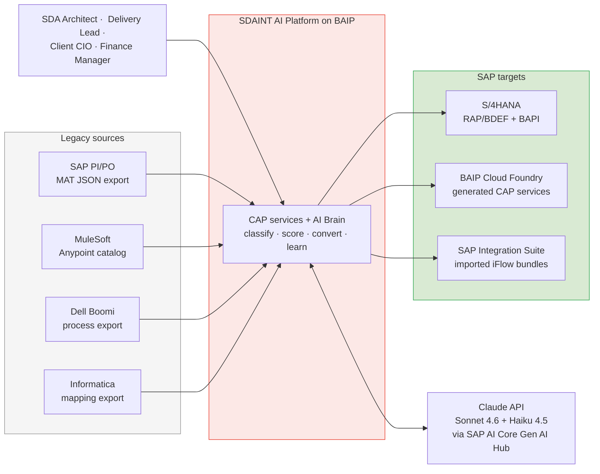
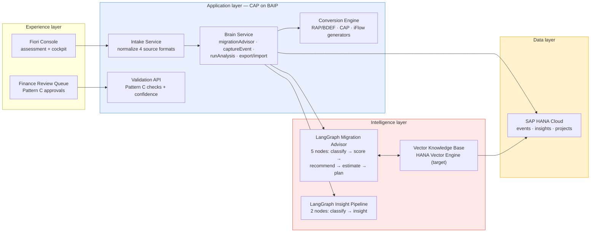
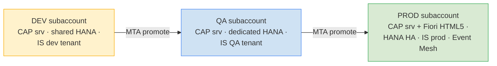
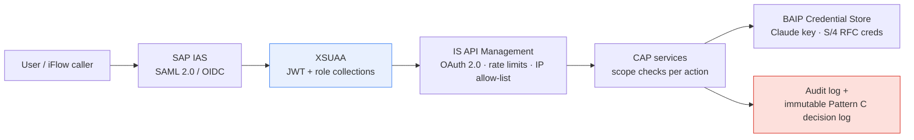
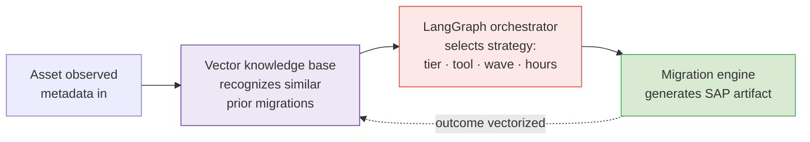
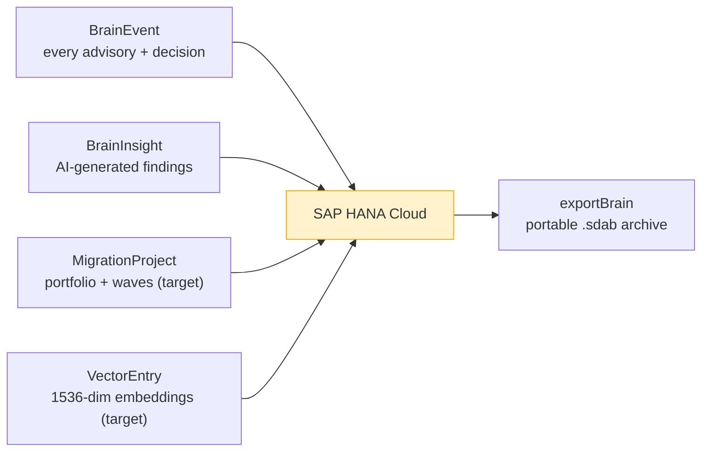

# SDAINT AI — Solution Architecture Document (SAD)
## AI-Powered SAP Integration Migration Platform

> **Document Type:** Solution Architecture Document (Arc42-aligned, 4+1 view model where applicable)
> **Classification:** SDA Proprietary | Client-Ready upon SDA review
> **Version:** 2.1 — July 2026 (complete redesign; supersedes SAD v1.1; adds sourced references §20)
> **Author:** **Ayman Kaabi Kabalan — Lead BAIP SAP Architect, SDA** · SDA Enterprise Architecture Practice
> **Diagram legend:** ⬜ grey = legacy sources · 🟥 red = AI brain · 🟦 blue = deterministic logic · 🟨 yellow = human decisions · 🟩 green = SAP output · 🟪 purple = knowledge/learning. All flows read left → right.
> **Audience:** Solution architects, SAP executives, implementation partners, project managers
> **Terminology:** **BAIP** = SAP Business AI Platform — SAP's current naming for the platform formerly known as SAP Business Technology Platform (BTP).
> **Program numbers:** locked task-level estimates and dates now live in `ONE-PAGER-Master-Task-Plan-Final.md` and `PLAN-05-Two-Golives-Simple.md`, not in this document.

---

## 1. Introduction

This document describes the solution architecture of **SDAINT AI**, SDA's AI-powered platform for migrating legacy integration estates — SAP PI/PO, MuleSoft, Dell Boomi, and Informatica — to the SAP-native target landscape: S/4HANA, SAP Integration Suite, and CAP services on BAIP.

It is written to be understood by both technical and non-technical readers. Every diagram reads **left to right**: source on the left, intelligence in the middle, SAP target on the right. Deep engineering detail lives in the TDD v2.1; commercial and financial detail lives in the Unified Blueprint v2.2.

> **If you read nothing else:** legacy interfaces go in on the left; an AI brain classifies each one, picks the right SAP target, estimates the hours, and generates the deployable artifact; humans review and approve; financial flows pass an AI firewall (Pattern C) before touching the books; and everything the platform learns makes the next migration faster. In SDA's lab, 10 real PI/PO interfaces took 60 hours by hand — the platform does the same work in 18 (Blueprint v2.2 §8).

## 2. Business Goals

| # | Goal | Owner |
|---|---|---|
| G1 | Win PI/PO → Integration Suite engagements against tool vendors and capacity SIs on AI-powered speed and quality | SDA Sales / Practice Lead |
| G2 | Compress the assessment phase from 6–10 weeks to 2–5 days per client landscape [1] | SDA Delivery |
| G3 | Build a compounding, proprietary knowledge asset from every delivery (the AI brain) | SDA Enterprise Architecture |
| G4 | Eliminate financial data migration risk via AI validation (Pattern C) | SDA Delivery / Client Finance |
| G5 | Cover four strategic legacy platforms — PI/PO, MuleSoft, Boomi, Informatica — with one conversion pipeline | SDA Practice Lead |
| G6 | Deliver converted, deployable packages (RAP/BDEF + BAPI, CAP services, IS artifacts) — not just recommendations | SDA Engineering |

## 3. Success Metrics

| Metric | Target | How measured |
|---|---|---|
| Assessment turnaround (inventory in → scored wave plan out) | ≤ 5 business days | Per engagement |
| Recommendation acceptance (architect accepts AI tier/tool) | ≥ 80% | Brain telemetry |
| Pattern C auto-post rate | ≥ 85% of records, **zero** bad postings | Per FI batch |
| Estimate accuracy (predicted vs actual hours) | ±20%, converging | `actualHours` feedback loop |
| Knowledge growth | Vector store grows every engagement; coherence trending up | `getBrainStatus` |
| Commercial | Package 1 → Package 3 conversion ≥ 50% | CRM |

## 4. Stakeholders

| Stakeholder | Needs from the system |
|---|---|
| **CIO / Integration Lead** (client) | Classified inventory, defensible wave plan, tool per object, risk register |
| **CFO / Business Sponsor** (client) | Budgetable cost model, ROI framing, license-retirement path |
| **Finance Manager** (client) | Pattern C review queue, side-by-side validation UI, audit trail, zero unvalidated postings |
| **SDA Architect** (operator) | Migration Advisor API, batch analysis, override capability, transparent rationale |
| **SDA Delivery Lead** (operator) | Multi-project dashboard, wave progress, high-risk alerts |
| **SDA Practice / Sales** | Branded executive PDF, engagement packages, competitive proof points |
| **SAP** (ecosystem) | SDA amplifies — never replaces — SAP tooling (MAT, Migration Wizard, Integration Advisor, Joule) |

## 5. Functional Scope

**In scope**

- Intake and normalization of legacy inventories: PI/PO (MAT JSON export), MuleSoft (Anypoint catalog), Boomi (process export), Informatica (mapping/workflow export)
- AI classification (Simple / Medium / Complex), complexity scoring, tool recommendation, effort estimation, wave planning
- **Convert & package**: generation of tier-specific deployable output — RAP/BDEF + BAPI packages, CAP integration services, IS iFlow bundles (incl. Integration Advisor MIG/MAG for EDI)
- Pattern C financial validation: validation API, ≥85% confidence routing, Fiori review queue, BAPI posting incl. tax handling
- Knowledge/vector store, event capture, insight generation, brain export/import
- Assessment deliverables: scored inventory, wave plan, risk register, branded executive PDF
- Migration Cockpit: portfolio, buckets, waves, approvals, execution tracking, metrics

**Out of scope**

- S/4HANA core configuration and client ABAP development
- Client network design; operation of the legacy runtimes
- Runtime execution of migrated iFlows (they run in the client's IS tenant; SDAINT AI advises, generates, and validates)
- HR record content processing (metadata only, by policy)

## 6. Architecture Principles

| # | Principle | Consequence |
|---|---|---|
| P1 | **SAP-first** | Every component is SAP-native unless SAP has no equivalent; the only external dependency is the Claude API (routed via SAP AI Core Generative AI Hub in target state) |
| P2 | **Deterministic floor, AI overlay** | Rules always compute a complete result; the LLM improves it but can never block it |
| P3 | **AI advises, humans decide** | Every material action (especially financial) has a human approval path and stored rationale |
| P4 | **Learn from every asset** | Every classification, conversion, and outcome is vectorized; the platform must get smarter per engagement |
| P5 | **Simple before clever** | Local JSON vectors before HANA Vector Engine; Event Mesh before AEM; scale infrastructure only when metrics demand it |
| P6 | **Deployable output** | Every assessment ends in artifacts a client can deploy, not only documents |
| P7 | **Everything explainable** | Tier, score, tool, and estimate each carry a stored, human-readable rationale |

## 7. System Context

Users interact through the Fiori console (and, in target state, SAP Joule); legacy inventories flow in from the left; deployable SAP artifacts flow out to the right; the Claude LLM is consulted for classification and plan narrative only.

## 8. High-Level Component Architecture

| Component | Responsibility | Key fact |
|---|---|---|
| Intake Service | Normalize the four source formats into one inventory model | Gap report produced on day 1 |
| Brain Service (CAP) | Exposes all AI actions as OData v4: `migrationAdvisor`, `captureEvent`, `runAnalysis`, `getBrainStatus`, `exportBrain`/`importBrain`, `seedMigrationKnowledge` | The rule-based advisor always computes a floor result first |
| LangGraph Migration Advisor | 5-node graph — classify (Claude Sonnet 4.6) → score (deterministic 8-factor) → recommend tool → estimate effort → build plan (Sonnet 4.6) | Graph output overlays the rule floor field-by-field |
| LangGraph Insight Pipeline | 2-node graph (classify → insight) on Claude Haiku 4.5 | Low-cost telemetry-to-insight conversion |
| Vector Knowledge Base | RAG store of every assessed object + outcome | Local JSON as-built; HANA Vector Engine at scale (AD-008) |
| Conversion Engine | Generates tier-specific artifacts per §9 of the TDD | Simple → RAP/BDEF+BAPI; Medium → CAP; Complex → iFlow bundle |
| Validation API (Pattern C) | Deterministic FI checks + confidence score + routing | ≥0.85 auto-post, else Fiori review queue |

> **Pattern C in plain words:** every financial record is checked (account exists, period open, debits = credits), the system scores its own confidence, records at ≥85% post automatically, everything else goes to a human reviewer — and no unvalidated record ever reaches S/4HANA. Full layman explanation: Blueprint v2.2 §7.

## 9. Deployment Architecture

| Artifact | Technology | Deployment unit |
|---|---|---|
| SDAINT AI Brain platform (CAP, Node.js 20) | `mta.yaml` (ID `SDAINTAI`) | BAIP Cloud Foundry, MTA (MBT) |
| Static web console (SDAINT-AI BTP cockpit) | `mta-sdaintai.yaml` (staticfile buildpack, 64M) | CF route `sdaintai.cfapps.us10.hana.ondemand.com` |
| HANA schema (CDS/HDI) | `db/*.cds` | HDI container via MTA |
| iFlow templates (Patterns A/B/C) | IS artifacts | IS Content API / Figaf CI-CD |
| Security descriptor | `xs-security.json` | XSUAA service instance |
| CI/CD | `Jenkinsfile`; Kyma/Helm option (`chart/`, `containerize.yaml`) | CF primary; K8s ready |

## 10. Infrastructure Architecture

All infrastructure is **SAP-managed PaaS** — no customer-managed VMs anywhere.

| Concern | Choice | Notes |
|---|---|---|
| Region | BAIP Canada East (data residency: Canada/North America) | Client-selectable per engagement |
| Runtime | Cloud Foundry (primary); Kyma/K8s prepared | CF instances: brain 2×512M target, console 64M staticfile |
| Database | HANA Cloud — shared (DEV) → dedicated (QA) → dedicated HA (PROD) | SQLite locally, PostgreSQL optional |
| Cache/state | Redis (BAIP hyperscaler option) | Session/state scaling option |
| Messaging | SAP Event Mesh → Advanced Event Mesh at multi-project scale | AMQP topics `sda/migration/…`, `sda/brain/…` |
| Egress | Single external endpoint: Claude API over HTTPS | Via AI Core Gen AI Hub (target); key in Credential Store |
| Private landscapes | Edge Integration Cell supported as advisory target | Advisory output is deployment-target-aware |

## 11. Security Architecture

| Layer | As-built (today) | Target |
|---|---|---|
| Platform identity | BAIP subaccount + IAS | IAS federated to client IdP where required |
| Service authorization | Shared master key on brain actions (**DEV-grade only**) | XSUAA JWT scopes: `MigrationAdvisor`, `BrainAdmin`, `FinanceReviewer` |
| API exposure | CAP OData over HTTPS | IS API Management front door |
| Secrets | Environment variables | BAIP Credential Store + Destination Service |
| Data isolation | Single project per deployment; brain export/import between projects | Row-level `projectId` predicate on every query |

### Data handling policy

| Data class | Policy |
|---|---|
| Interface metadata (names, adapters, volumes) | Stored in brain; sent to Claude for classification — never message payloads |
| Financial records (Pattern C) | Validated in-memory only; brain stores GL account, amount range, confidence, outcome — never full documents |
| HR master data | Metadata only, always Complex tier; employee records never enter the platform |
| Brain exports (`.sdab`) | SDA Confidential; encrypted at rest; contractual right-to-delete per client |
| LLM governance | Prompts + model versions pinned; rationale stored per decision; human approval for all material financial actions |

## 12. Identity & Access

| Persona | Role collection | Can do |
|---|---|---|
| SDA Architect | `MigrationAdvisor` | Run assessments, review/override recommendations |
| SDA Delivery Lead | `MigrationAdvisor` + dashboard | Multi-project view, wave management |
| Finance Reviewer (client) | `FinanceReviewer` | Approve/reject Pattern C exceptions only |
| Brain Administrator | `BrainAdmin` | Toggle brain, seed knowledge, export/import |
| iFlow (system) | OAuth client credentials | Call validation API only, IP allow-listed |

## 13. High Availability & Disaster Recovery

| Aspect | Design |
|---|---|
| Platform availability | 99.5% (BAIP CF SLA); stateless CAP instances scale horizontally |
| Database HA | HANA Cloud HA in PROD (SAP-managed replicas) |
| LLM outage | **Zero assessment downtime** — rule-based advisor is always computed first and stands alone if the graph/Claude is unavailable (verified in code) |
| Brain state DR | `exportBrain` produces a portable `.sdab` archive (events, insights, sessions, vectors); scheduled exports = point-in-time recovery |
| Deployment rollback | Blue-green via MTA; cds-mtx upgrade hooks |
| RPO / RTO (target) | RPO ≤ 24h (daily brain export + HANA backups), RTO ≤ 4h (redeploy MTA + import) |

## 14. Performance & Scalability

| Scenario | Target | Mechanism |
|---|---|---|
| Single-object assessment | < 30 s (LLM path); **< 2 s** (rule path) | One Sonnet call for classify+plan; everything else deterministic |
| Batch (127-ICO MAT export) | < 5 min | Chunked parallel Claude calls (10-item chunks, `Promise.allSettled`) |
| RAG similarity query | < 500 ms | In-memory cosine (as-built); HANA `COSINE_SIMILARITY` (target) |
| Pattern C per-record validation | < 10 s | Deterministic checks first; LLM only for ambiguous cases |
| Objects per batch | 1,000+ | Stateless graph invocations, async CAP handlers |
| Concurrent client projects | 10+ (target) | `projectId` row isolation; per-project export/import interim |

**Scale triggers (act only when hit — Principle P5):** >10K vectors or first multi-client PROD → HANA Vector Engine; sustained event fan-out across projects → Advanced Event Mesh; >3 concurrent projects → mtx multi-tenant activation.

## 15. Monitoring, Logging & Audit

| Concern | Mechanism |
|---|---|
| Application logs | SAP Application Logging service (bound in MTA) |
| Platform health | `getBrainStatus` — events count, insights count, vector count, coherence score, enabled-since |
| AI decision audit | One `BrainEvent` per advisory/decision with payload, summary, and embedding reference |
| Financial audit | Immutable Pattern C decision log: record, confidence, verdict, approver identity, S/4 document number; AEM audit topic `sda/migration/fi/posted` |
| Alerting | `sda/brain/alert/high-risk-object` events; BAIP Alert Notification (target) |
| Cost observability | Claude token usage logged per action; monthly LLM budget report |

## 16. AI Components

The AI explanation, simplified: **the AI observes migration assets → the vector database recognizes patterns → the orchestration engine selects the best migration strategy → the migration engine generates the recommended SAP artifact.**

### LangGraph Brain
Two compiled graphs orchestrate all AI work. The **Migration Advisor** (5 nodes) drives assessment; the **Insight Pipeline** (2 nodes, Claude Haiku 4.5) turns captured platform events into prioritized insights. Graphs are deterministic state machines: every LLM node has a rule-based fallback, and outputs merge over the always-computed rule floor.

### LangChain
Provides the model bindings (`@langchain/anthropic`), prompt templating, and JSON-mode output parsing beneath LangGraph. License cost: $0 (MIT open source).

### HANA Vector Database
Target-state RAG store: `VectorEntry` (1536-dim real embeddings) in HANA Cloud Vector Engine, queried with `COSINE_SIMILARITY()`. One database engine for business data *and* vectors — no separate vector-DB license, no data movement, row-level `projectId` security applies to vectors identically. As-built interim: local JSON store with 128-dim deterministic embeddings behind the same `add/search/getAll/replaceAll` interface — swap-ready.

### SAP AI Core
Target-state LLM gateway: Claude models consumed through the **Generative AI Hub** in SAP AI Core, giving SAP-native procurement, metering, prompt logging, and model governance. Also the future host for embedding generation. Until then, direct Anthropic API access with the key in the Credential Store.

### Joule
SAP's copilot is treated as a **client-side surface, not a dependency**: SDAINT AI exposes clean OData v4 actions that Joule (or any assistant) can call — "Joule, what's the migration recommendation for MATMAS?" resolves to `migrationAdvisor`. This keeps SDAINT AI complementary to SAP's AI roadmap rather than competitive with it.

## 17. Data Storage

| Entity | Purpose | Store |
|---|---|---|
| `BrainEvent` | Every advisory, capture, decision — type, source, payload, summary, embedding ref | HANA (SQLite dev) |
| `BrainInsight` | Prioritized insights from the Haiku pipeline | HANA |
| `BrainSession` / `BrainConfig` | Session telemetry, config keys | HANA |
| `VectorEntry` (target) | Embedding + content + tier + outcome + `projectId` | HANA Vector Engine |
| `MigrationProject` (target) | Client, source system, phase, wave, coherence | HANA |
| Brain archive | Full-state export/import (base64 `.sdab`) | File — interim isolation + DR |

## 18. SAP Landscape Alignment

| SAP element | Role in SDAINT AI |
|---|---|
| **SAP Integration Suite** | Target runtime for Complex tier; MAT feeds intake; Migration Wizard and Integration Advisor (MIG/MAG) are leveraged, not replaced; API Management fronts the platform APIs |
| **BAIP services** | CF runtime, HANA Cloud, XSUAA, IAS, Destination + Connectivity, Credential Store, Event Mesh/AEM, Application Logging, Audit Log, HTML5 repo, Portal |
| **ABAP Cloud** | The clean-core programming model our Simple-tier output targets; generated RAP artifacts are ABAP-Cloud-compliant (released APIs only) |
| **S/4HANA** | Simple-tier destination; Pattern C posts via `BAPI_ACC_DOCUMENT_POST` with full tax handling (`ACCOUNTTAX`, OB40/FTXP keys) and commit/rollback discipline |
| **RAP** | Generated behavior definitions (BDEF) give validated, transactional CRUD on the digital core — the modern replacement for point-to-point interface code |
| **CAP** | Both the platform's own runtime **and** the Medium-tier output format — SDAINT AI generates what it is built from, so every generated service inherits the platform's own patterns |

## 19. Architecture Decisions (summary)

| AD | Decision | Rationale |
|---|---|---|
| AD-001 | CAP on BAIP CF (not Kyma-first) | Fastest SAP-native path; Kyma kept as option via Helm chart |
| AD-002 | LangGraph for orchestration (not custom code / SAP Build) | Deterministic graphs, OSS, testable nodes, model-agnostic |
| AD-003 | Claude Sonnet 4.6 + Haiku 4.5 split | Advisory quality where it matters; 3–5× cheaper insight path |
| AD-004 | Rule floor beneath every LLM call | Availability + explainability + cost control |
| AD-005 | Three-tier output model (RAP / CAP / iFlow) | Right-sized target per asset; avoids "everything becomes an iFlow" cost trap |
| AD-006 | 85% Pattern C confidence threshold | Conservative by design; threshold recalibrated per record family from review outcomes |
| AD-007 | Event Mesh now, AEM at scale | Defer ~$1–2K/month broker cost until event volume justifies |
| AD-008 | Local JSON vectors → HANA Vector Engine at >10K vectors or first multi-client PROD | Ship-fast pragmatism with an explicit, metric-gated migration trigger |
| AD-009 | LLM via AI Core Gen AI Hub (target) | SAP procurement, governance, and metering for the single external dependency |

## 20. References & Sources

This document is architecture-focused and doesn't itself make the competitor cost/timeline claims that most need sourcing (Crave InfoTech, Bluethink) — those live in `SDAINTAI-Blueprint.md` §14 and `SDAINTAI-Unified-Architecture.md` Appendix C, including an open sourcing gap on the Bluethink figures that should be resolved before external distribution. The one figure cited directly in this document:

1. **SAP Migration Assessment Tool documentation** — https://help.sap.com/docs/integration-suite/sap-integration-suite/migration-assessment. Describes SAP's own free scoring/ICO-assessment tool. The "6–10 week manual assessment" baseline this document compresses against is SDA's own delivery-pattern estimate for the human assessment phase this tool doesn't automate, not a SAP-published figure. Full detail: Blueprint §14 item 2.

---

*SDAINT AI Solution Architecture Document v2.1 — July 2026 (References added §20)*
*Ayman Kaabi Kabalan — Lead BAIP SAP Architect, SDA*
*SDA — SAP Integration Suite Migration Factory Partner (North America)*
