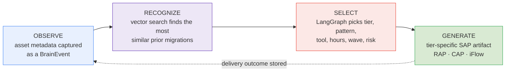
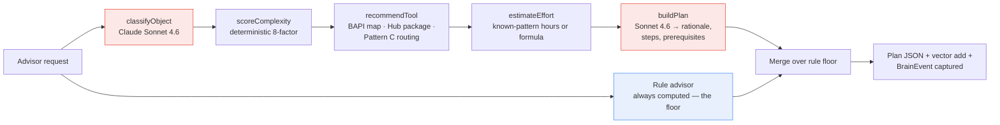
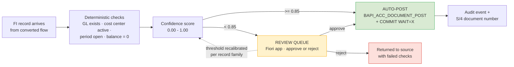

# SDAINT AI — Technical Design Document (TDD)
## The Engineering Blueprint for Migration Execution

> **Document Type:** Technical Design Document
> **Classification:** SDA Internal | Engineering Reference (client-shareable extracts)
> **Version:** 2.1 — July 2026 (complete redesign; supersedes TDD v1.1; adds sourced references §11)
> **Author:** **Ayman Kaabi Kabalan — Lead BAIP SAP Architect, SDA** · SDA Engineering Practice
> **Diagram legend:** ⬜ grey = legacy sources · 🟥 red = AI brain · 🟦 blue = deterministic logic · 🟨 yellow = human decisions · 🟩 green = SAP output · 🟪 purple = knowledge/learning. All flows read left → right.
> **Audience:** Engineers, integration consultants, solution architects, project managers
> **Design goal of this document:** *every engineer should understand the migration process within minutes.* Every flow reads left to right. Simplified SAP terminology throughout.
> **Terminology:** **BAIP** = SAP Business AI Platform (formerly SAP BTP).
> **Program numbers:** locked task-level estimates and dates now live in `ONE-PAGER-Master-Task-Plan-Final.md` and `PLAN-05-Two-Golives-Simple.md`, not in this document.

---

## 1. The Migration Process in One Picture

Every migration — regardless of source platform — follows the same conveyor. Only the **intake adapter** (step 1) differs per source.

```mermaid
graph LR
    A["1 · DISCOVER<br/>ingest legacy inventory"] --> B["2 · CLASSIFY<br/>what kind of asset is it?"]
    B --> C["3 · ASSESS<br/>AI pattern recognition:<br/>tier · pattern · hours · risk"]
    C --> D["4 · PLAN<br/>wave · team · approval"]
    D --> E["5 · CONVERT<br/>generate the SAP artifact"]
    E --> F["6 · VALIDATE<br/>checks + Pattern C for FI"]
    F --> G["7 · DEPLOY & TEST<br/>into client landscape"]
    G --> H["8 · PRODUCTION<br/>cutover + learn"]
    H -.actuals train the brain.-> C

    style C fill:#fce8e6,stroke:#ea4335
    style E fill:#d9ead3,stroke:#34a853
    style F fill:#fff2cc,stroke:#f9ab00
```



**Why each stage exists:**

| Stage | What happens | Why it happens |
|---|---|---|
| Discover | Legacy export is parsed and normalized | You cannot migrate what you have not inventoried; gaps surface on day 1, not month 4 |
| Classify | Asset typed as Master Data / Transactional / Technical / Custom | The asset type predicts the migration pattern better than any other single fact |
| Assess | AI brain scores complexity, picks the pattern, estimates hours/days, assigns risk | Consistent, explainable judgment — the step where projects traditionally go wrong |
| Plan | Wave assignment, team assignment, human approval | Sequencing controls risk; simple assets first builds confidence and trains the brain |
| Convert | The tier-specific SAP artifact is generated | Deployable output is the deliverable — not a recommendation document |
| Validate | Automated checks; financial flows pass the Pattern C firewall | One bad FI posting costs more than the whole migration; zero-unvalidated-postings rule |
| Deploy & Test | Artifact deployed to DEV → QA; Int4-style regression against legacy behavior | Prove equivalence before cutover |
| Production | Cutover per runbook; actual hours captured | The actuals feed back and make the next estimate better |

## 2. Migration Flows per Source Platform

### 2.1 SAP PI/PO → SAP targets

```mermaid
graph LR
    subgraph SRC["Legacy PI/PO"]
        A["ICOs · mappings ·<br/>ccBPM · adapters"]
    end

    subgraph DISC["Discovery"]
        B["MAT JSON export<br/>ingested"] --> C["Identify integration assets<br/>per ICO: adapter, segments,<br/>mapping type, volume"]
        C --> D["Classify asset<br/>Master Data / Transactional /<br/>Technical / Custom"]
    end

    subgraph BRAIN["AI assessment"]
        E["AI pattern recognition<br/>HANA vectors + LangGraph + LangChain"] --> F["Identify migration pattern"]
        F --> G["Estimate complexity → hours → days"]
    end

    subgraph PLAN["Planning"]
        H["Assign wave"] --> I["Assign team"] --> J["Approve wave"]
    end

    subgraph EXEC["Execution"]
        K["Execute conversion"] --> L["Generate output"]
    end

    A --> B
    D --> E
    G --> H
    J --> K
    L --> M["Validation → Deployment →<br/>Testing → Production"]

    style BRAIN fill:#fce8e6,stroke:#ea4335
    style EXEC fill:#d9ead3,stroke:#34a853
```



**Possible PI/PO outputs** (chosen by the AI, confirmed by the architect):

| Output | When |
|---|---|
| SAP Integration Suite iFlow | Stateful, multi-partner, high-volume, or ccBPM-derived scenarios |
| S/4HANA BAdI | Logic that belongs inside the application core |
| ABAP / RAP service (BDEF) | Simple master-data or transactional posting — no middleware hop needed |
| API (API Management) | Interface consumers need a managed, governed endpoint |
| CAP service wrapper | Transformation/orchestration logic best expressed cloud-natively |
| Manual conversion | Genuinely bespoke assets — routed to a senior architect with an AI-generated plan |

**PI/PO-specific classification inputs:** IDoc type (MATMAS, DEBMAS, ORDERS05, …), segment count, Z-fields, mapping technology (graphical / XSLT / Java / ABAP), adapter type (IDoc / SOAP / RFC / SFTP / JDBC / AS2 / JMS), daily volume, ccBPM flag, EDI flag.

#### Lab-verified PI/PO baseline (July 2026)

SDA manually migrated 10 real PI/PO interfaces to Integration Suite (tenant `lab-sda.it-cpi019`, package `PJ1_2_IS_MIGRATION`) and timed each one: **4 h migrate + configure, 2 h test — 6 h per interface, 60 h total.** These are the engineering reference numbers behind every estimate in the commercial documents.

| # | Asset | IDoc / BAPI | Sender → Receiver | iFlow ID | Manual (hrs) | SDAINT AI target (hrs) |
|---|---|---|---|---|---|---|
| 1 | Material Master | MATMAS07 | IDoc → HTTP | MAS_Material_Master | 4 + 2 | 1.8 |
| 2 | Customer Master | DEBMAS08 | IDoc → SFTP | MAS_Customer_Master | 4 + 2 | 1.8 |
| 3 | Vendor Master | CREMAS07 | IDoc → SFTP | MAS_Vendor_Master | 4 + 2 | 1.8 |
| 4 | Sales Orders | BAPI_SALESORDER_CREATEFROMDAT2 (Z-wrapper) | SOAP → RFC | O2C_Sales_Order | 4 + 2 | 1.8 |
| 5 | Delivery | DELVRY03 (DESADV) | IDoc → SFTP | O2C_Delivery | 4 + 2 | 1.8 |
| 6 | Invoice (Billing) | INVOIC02 | IDoc → SFTP | O2C_Invoice | 4 + 2 | 1.8 |
| 7 | Shipment | SHPMNT05 | IDoc → SFTP | O2C_Shipment | 4 + 2 | 1.8 |
| 8 | Purchase Order | ORDERS05 | HTTPS → IDoc | P2P_Purchase_Order | 4 + 2 | 1.8 |
| 9 | Goods Receipt | MBGMCR03 | HTTPS → IDoc | P2P_Goods_Receipt | 4 + 2 | 1.8 |
| 10 | FI Document | BAPI_ACC_DOCUMENT_POST (Z-wrapper) | HTTPS → RFC | FIN_Document | 4 + 2 | 1.8 + Pattern C |
| | | | | **Total** | **60 h** | **18 h (−70%)** |

The SDAINT AI target splits per interface as ~1.2 h human configuration/review + ~0.6 h assisted testing; classification, pattern match, and artifact generation are automated (all 10 objects are seeded patterns). Timeline diagrams and the full cost math: **Blueprint v2.2 §8**.

### 2.2 MuleSoft → SAP targets

```mermaid
graph LR
    A["MuleSoft Anypoint<br/>flows · DataWeave · APIs"] --> B["Flow catalog export<br/>ingested"]
    B --> C["Identify assets<br/>flows, connectors,<br/>DataWeave scripts, API specs"]
    C --> D["Classify asset<br/>Master Data / Transactional /<br/>Technical / Custom"]
    D --> E["AI pattern recognition<br/>vectors + LangGraph"]
    E --> F["Pattern → complexity →<br/>hours → days → wave → team"]
    F --> G["Approve → convert"]
    G --> H["Outputs: iFlow · CAP service ·<br/>API Mgmt proxy · RAP service"]
    H --> I["Validate → deploy →<br/>test → production"]

    style E fill:#fce8e6,stroke:#ea4335
    style H fill:#d9ead3,stroke:#34a853
```



**MuleSoft-specific notes:** DataWeave transformations map to message-mapping/Groovy in iFlows or JavaScript in CAP; API specifications (RAML/OAS) migrate near-1:1 into SAP API Management; the commercial driver is license retirement ($400K–$600K/yr) [1].

### 2.3 Dell Boomi → SAP targets

```mermaid
graph LR
    A["Dell Boomi<br/>processes · connectors · maps"] --> B["Process inventory<br/>export ingested"]
    B --> C["Identify assets<br/>processes, connector types,<br/>map components"]
    C --> D["Classify asset"]
    D --> E["AI pattern recognition"]
    E --> F["Pattern → complexity →<br/>hours → days → wave → team"]
    F --> G["Approve → convert"]
    G --> H["Outputs: iFlow · CAP service ·<br/>direct S/4 posting"]
    H --> I["Validate → deploy →<br/>test → production"]

    style E fill:#fce8e6,stroke:#ea4335
    style H fill:#d9ead3,stroke:#34a853
```



**Boomi-specific notes:** Boomi processes are typically fine-grained — many collapse into fewer, better-factored iFlows or one CAP service; connector inventory maps to IS adapter availability first, gaps flagged as Complex.

### 2.4 Informatica → SAP targets

```mermaid
graph LR
    A["Informatica<br/>mappings · workflows · sessions"] --> B["PowerCenter / IICS<br/>repository export ingested"]
    B --> C["Identify assets<br/>mappings, workflows,<br/>transformation logic"]
    C --> D["Classify asset"]
    D --> E["AI pattern recognition"]
    E --> F["Pattern → complexity →<br/>hours → days → wave → team"]
    F --> G["Approve → convert"]
    G --> H["Outputs: iFlow · CAP service ·<br/>RAP/BAPI data load · SDI/SLT handoff"]
    H --> I["Validate → deploy →<br/>test → production"]

    style E fill:#fce8e6,stroke:#ea4335
    style H fill:#d9ead3,stroke:#34a853
```



**Informatica-specific notes:** pure data-movement mappings often belong in SAP data-integration tooling (SDI/SLT/Datasphere) rather than Integration Suite — the AI flags these as a distinct pattern; heavy transformation workflows become CAP services or iFlows with script steps.

## 3. Asset Classification Model

Every asset, from every source, lands in one of four classes — because the class predicts the pattern:

| Class | Examples | Typical tier | Typical output |
|---|---|---|---|
| **Master Data** | MATMAS, DEBMAS, CREMAS, GLMAST, product/customer syncs | Simple–Medium | RAP/BDEF + BAPI direct to S/4 |
| **Transactional** | ORDERS05, INVOIC02, DESADV, payment runs | Medium–Complex | iFlow or CAP service; Pattern C if financial |
| **Technical** | File transfers, pollers, routers, pub/sub | Simple–Medium | iFlow (Pattern A) or CAP service |
| **Custom** | ccBPM, custom Java/DataWeave logic, EDI trading partners | Complex | Redesign: Build Process Automation, Integration Advisor MIG/MAG, custom iFlow |

## 4. The AI Brain — Simple Explanation

> **The AI observes migration assets. The vector database recognizes patterns. The orchestration engine selects the best migration strategy. The migration engine generates the recommended SAP artifact.** That is the whole concept — everything below is implementation detail.



Three engineering guarantees behind the simple story:

1. **The rules always answer first.** A deterministic advisor computes a complete result (tier, tool, hours, wave) for every request. The LangGraph/Claude result overlays it field-by-field. If the LLM is down, slow, or wrong-shaped, the assessment still completes in under 2 seconds.
2. **Known patterns skip the LLM.** 19 seeded SAP object patterns (GLMAST, MATMAS, DEBMAS, ORDERS05, INVOIC02, …) carry curated tier/tool/hours — the fast path costs zero tokens.
3. **Every answer is explainable.** Tier, score, tool, and estimate each store a human-readable rationale; the architect can override any field, and the override is captured as training signal.

### 4.1 Migration Advisor graph (engineering view)



**Complexity scoring (node 2, deterministic):** segments (>15 → +6, >5 → +3, else +1) · Z-fields (+4) · mapping type (Java/ABAP +6, XSLT +3) · volume (>100K/day +6, >10K +3) · adapter (AS2/JMS/custom +6, JDBC/RFC +3) · EDI (+4) · BPM (+10) · FI/HR elevation (+3). Tier: ≤8 Simple, ≤18 Medium, else Complex. `complexityScore = min(100, round(score/30·100))`.

**Effort formulas (node 4):** known-pattern hours take precedence; otherwise Simple `4 + 0.3·segments` · Medium `16 + 0.5·segments + 8·zFields` · Complex `60 + 0.8·segments + 20·EDI + 40·BPM`. Days = hours ÷ 6 productive hours; both are surfaced.

> **In plain words:** if the brain has seen this object before, it quotes the hours it actually took. If not, it starts from a base price per tier (like a garage's standard job rate) and adds a surcharge for each thing that makes the job harder — more data segments, custom Z-fields, EDI partners, embedded BPM workflows. Every delivered wave feeds `actualHours` back in, so the quotes tighten toward ±20% over time.

**Tool routing (node 3):** Simple → BAPI package (from `BAPI_MAP`, fallback `BAPI_{ID}_SAVE`) · Medium → `iFlow_SemiAuto` with SAP Business Accelerator Hub package match, else `iFlow_Custom` · Complex FI/HR → `LangChain_Pattern_C` (AI-guarded iFlow) · other Complex → full iFlow rebuild / redesign path.

### 4.2 API contract — `migrationAdvisor` (OData v4 action)

Request:

```json
{
  "objectId": "MATMAS",
  "objectDesc": "Material master replication to 3 plants with Z-fields",
  "segmentCount": 38,
  "hasZFields": true,
  "mappingType": "graphical | xslt | java | abap",
  "adapterType": "idoc | soap | rfc | sftp | jdbc | as2 | jms | rest | custom",
  "volumePerDay": 12000,
  "isBpmProcess": false,
  "isEdiBased": false,
  "sourceSystem": "PI_PO | MULESOFT | BOOMI | INFORMATICA"
}
```

Response:

```json
{
  "objectId": "MATMAS",
  "objectType": "MASTER_DATA_MATMAS",
  "tier": "medium",
  "complexityScore": 55,
  "recommendedTool": "iFlow_SemiAuto",
  "specificTool": "SAP S/4HANA Material Replication",
  "estimatedHours": 20,
  "riskLevel": "medium",
  "waveAssignment": 2,
  "rationale": "2-3 sentence AI-generated explanation",
  "steps": "[\"…\"]",
  "prereqs": "[\"IS tenant configured\", \"RFC destination to S/4\"]"
}
```

Other exposed actions: `captureEvent`, `runAnalysis`, `getBrainStatus`, `seedMigrationKnowledge`, `exportBrain` / `importBrain` (base64 `.sdab` archives), `toggleBrain`. Auth: master key as-built → XSUAA scopes (`MigrationAdvisor`, `BrainAdmin`, `FinanceReviewer`) per hardening stage H1.

## 5. Migration Cockpit

The cockpit is the delivery lead's single pane of glass — portfolio in, completion out:

```mermaid
graph LR
    A["Migration portfolio<br/>all assets, all sources"] --> B["Migration buckets<br/>Simple / Medium / Complex<br/>by asset class"]
    B --> C["Wave planning<br/>risk-sequenced groups"]
    C --> D["Approvals<br/>architect + client sign-off"]
    D --> E["Execution<br/>conversion per asset"]
    E --> F["Testing<br/>regression vs legacy behavior"]
    F --> G["Deployment<br/>DEV → QA → PROD"]
    G --> H["Metrics<br/>estimated vs actual ·<br/>acceptance rate · risk burn-down"]
    H --> I["Completion<br/>wave closed · brain updated"]

    style A fill:#e8f0fe,stroke:#4285f4
    style D fill:#fff2cc,stroke:#f9ab00
    style H fill:#ede7f6,stroke:#673ab7
    style I fill:#d9ead3,stroke:#34a853
```



**Wave sequencing rules (why, not just what):** Wave 1 = high-count, low-risk Simple assets (builds momentum, trains the brain on this client's landscape); middle waves = Medium tier grouped by business domain (bounded blast radius per cutover); final waves = Complex + financial assets (maximum accumulated knowledge and test coverage when it matters most).

**Cockpit metrics surfaced:** objects per tier and wave, estimated vs actual hours per wave, recommendation acceptance rate, Pattern C auto-post rate, high-risk alerts (`sda/brain/alert/high-risk-object`), coherence score.

## 6. Pattern C — The Financial Firewall

> **In plain words:** Pattern C is a checkpoint that every financial record must pass before it may touch the client's books — like an experienced accounts clerk who never gets tired. Records the system is ≥85% confident about post automatically; everything else waits for a human. Nothing unvalidated ever reaches S/4HANA. (Layman walk-through: Blueprint v2.2 §7.)

Financial flows get one extra, non-negotiable stage between conversion and posting:



**Posting discipline (verified reference implementation):** gross AR debit (`ACCOUNTRECEIVABLE`), net revenue credit with `TAX_CODE` (`ACCOUNTGL`), one `ACCOUNTTAX` row per tax component (GST `MWS` / QST `MW1` account keys, condition keys per FTXP), `AMT_BASE` on tax rows, `BAPI_TRANSACTION_COMMIT (WAIT='X')` on success, rollback on any `RETURN` type E/A. Full walk-through: `docs/howtocallbapiandaddtaxtonetamount.md`.

**Rules:** no unvalidated record ever reaches S/4; every decision writes an immutable audit event with confidence, verdict, and approver; rejected/approved outcomes recalibrate the threshold per record family (the firewall also learns).

## 7. Conversion Output Specifications

| Tier | Generated artifact | Contents | Deployment |
|---|---|---|---|
| **Simple** | RAP/BDEF + BAPI package | Behavior definition, mapping sheet, BAPI call module (e.g. `BAPI_MATERIAL_SAVEDATA`, `BAPI_ACC_DOCUMENT_POST`), unit test stubs | Transport to S/4HANA |
| **Medium** | CAP integration service | CDS model, Node.js handlers, OData v4 API, `mta.yaml`, destination config | MTA deploy to BAIP CF |
| **Complex** | IS artifact bundle | iFlow(s), value mappings, externalized parameters, Integration Advisor MIG/MAG (EDI), Int4-style test plan | Import via IS Content API |
| **Per wave** | Migration Package | All tier artifacts + cutover runbook with rollback points | Client hand-off |

## 8. Eventing & Integration Matrix

| # | Interface | Direction | Protocol |
|---|---|---|---|
| I1 | MAT assessment import | IS → SDAINT AI | REST/JSON |
| I2 | `migrationAdvisor` | client / iFlow → SDAINT AI | OData v4 action |
| I3 | Batch `runAnalysis` | operator → SDAINT AI | OData v4 action |
| I4 | Pattern C validation | IS iFlow → SDAINT AI | REST (HTTPS) |
| I5 | Simple-tier posting | generated package → S/4 | RAP OData / RFC-BAPI |
| I6 | Medium-tier deploy | SDAINT AI → BAIP CF | MTA |
| I7 | Complex-tier import | SDAINT AI → IS tenant | IS Content API |
| I8 | Brain/migration events | SDAINT AI ↔ Event Mesh/AEM | AMQP — `sda/migration/fi/posted`, `sda/migration/batch/{wave}/complete`, `sda/brain/alert/high-risk-object` |
| I9 | LLM | SDAINT AI → Claude (via AI Core Gen AI Hub, target) | HTTPS |

## 9. Technology Stack (engineering reference)

| Layer | Technology | Version |
|---|---|---|
| Runtime | SAP CAP Node.js, `@sap/cds` 9.x, Node 20 LTS, cds-mtxs sidecar | as-built |
| AI orchestration | `@langchain/langgraph` 1.4.x, `langchain` 1.5.x, `@langchain/anthropic` | as-built |
| LLM | `claude-sonnet-4-6` (advisory, maxTokens 1024) · `claude-haiku-4-5` (insights, maxTokens 512) | pinned |
| Vector store | Local JSON (128-dim, cosine) → HANA Cloud Vector Engine (1536-dim) | AD-008 |
| DB | HANA Cloud (`@cap-js/hana`) / SQLite dev / PostgreSQL option | as-built |
| Eventing | Event Mesh (`enterprise-messaging`) · `kafkajs` present | as-built |
| Cache | Redis 5.x client | option |
| UI | SAPUI5 / Fiori + static console (Staticfile buildpack) | as-built |
| Deploy | MTA (MBT 1.2.x) → CF us10; Jenkinsfile; Helm chart for Kyma | as-built |
| iFlow lifecycle | Figaf Migration Edition (CI/CD) [3], Int4 Shield Lite (regression) [2] — both free 12 months via SAP promotion | engagement |

## 10. Production Hardening Roadmap (engineering backlog)

| Stage | Item | Exit criterion |
|---|---|---|
| H1 | XSUAA on all brain actions; retire master key | Pen-test pass; no shared secrets |
| H2 | `projectId` multi-tenancy on BrainEvent + vectors | Two concurrent projects, verified isolation |
| H3 | HANA Vector Engine + real embeddings (AI Core) | RAG A/B vs local store; >10K vector scale test |
| H4 | Pattern C validation API + Fiori review queue productionized | First FI batch ≥85% auto-post, zero bad postings |
| H5 | `MigrationProject` entity + multi-project cockpit | Delivery lead runs 3 projects from one screen |
| H6 | Event Mesh topic wiring + high-risk alerting | Event-driven wave dashboard live |

## 11. References & Sources

This is an engineering document; it doesn't make the competitor cost/timeline claims that need sourcing (Crave InfoTech, Bluethink) — those live in `SDAINTAI-Blueprint.md` §14 and `SDAINTAI-Unified-Architecture.md` Appendix C, which readers should consult for the full analysis including an open sourcing gap on the Bluethink figures. The two figures cited directly in this document:

1. **MuleSoft Anypoint Platform pricing** — no public list price (mulesoft.com/anypoint-pricing is sales-negotiated). The $400K–$600K/yr enterprise range is an order-of-magnitude estimate from third-party pricing analyses (integrate.io, cloudconsultings.com), not a MuleSoft-published figure. Full detail: Blueprint §14 item 6.
2. **Int4 Shield (Lite edition)** — free 12 months via SAP promotion: https://int4.com/shield.
3. **Figaf Migration Edition** — free 12 months via SAP promotion: https://figaf.com.

---

*SDAINT AI Technical Design Document v2.1 — July 2026 (References added §11)*
*Ayman Kaabi Kabalan — Lead BAIP SAP Architect, SDA*
*SDA — SAP Integration Suite Migration Factory Partner (North America)*
